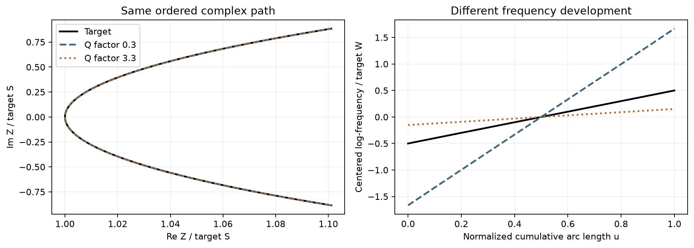
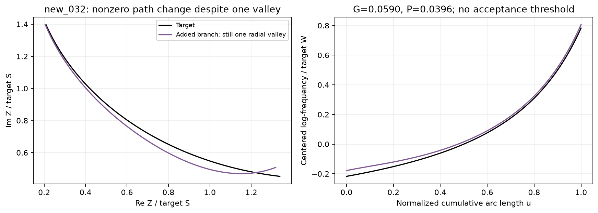
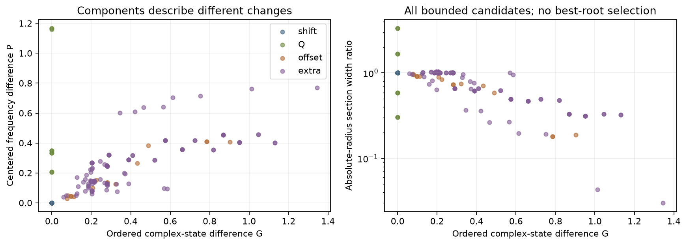
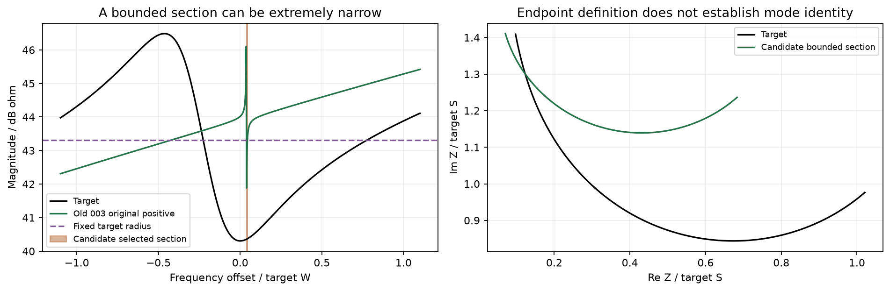

# 复阻抗轨迹的形态与频率展开：受控实验报告

日期：2026-10-17。范围：本地机制控制实验及旧候选诊断。方案、134项新构造和实现均在执行前冻结；没有新增优化、服务器任务、监控或网站发布。

## 1. 主要结论

本轮支持将复阻抗过程分成三个可分别核查的部分：**有序复状态路径、变化发生的频率位置、沿频率展开的宽窄与节奏**。它们不能互相代替。

49项具有已知几何恒等关系的控制全部通过：Q变化可以使复平面路径和路径长度几乎保持不变，同时将频率宽度变为原来的约0.303—3.333倍。纯移频则保持形态和展开宽度，单独改变中心位置。由此，单用“轨迹形态相似”不足以约束完整的三维曲线；还需保留频率坐标。

本轮形成了可运行的候选诊断分量 **G（有序复状态差）和P（去中心后的频率展开差）**，并保留路径量、中心偏移和额外极值。这些分量有受控物理变化的解释依据，但尚未证明能改善优化，也没有形成一般形变的可靠归属判据。

最主要的未解决问题是**过程截取和多候选归属**：一个固定半径截段可能包含多个谷，也可能只截到狭窄的局部部分。不能直接把本轮分量合成总分，再以最小分数强制选谷。

## 2. 方法：同时保留复状态及频率

记x=log10(f)，Z=R+jX。使用固定目标尺度S=|Z_target(x_center)|，固定绝对阻抗边界h=S×10^(3/20)。候选不能用自己的谷底幅值改变这条边界。

在目标谷中心左右各4个原目标核心宽度W内，列出全部严格径向谷。对每个谷，寻找左右最近的|Z|=h横截点：

- 谷底高于边界：记录“谷底高于比较半径”，不记零误差；
- 有一侧未穿过边界：记录“开放截段”，不强行补端点；
- 两侧均有横截点：记录有界段，同时保留段内所有峰谷。

对有界段按归一化累计弧长u∈[0,1]保存257个复状态Z(u)及其频率x(u)。u用于按轨迹进程对应采样，不平移、旋转或按候选幅值缩放复状态。各量分开报告：

|分量|定义|解释及限制|
|---|---|---|
|G|max_u abs(Z(u)−Z_target(u))/S|是否按相同顺序经过相似的端口复状态；单独不约束频宽|
|L/L_target|实际复轨迹总长度比|变化总量；不能代替状态及方向顺序|
|Δx/W|候选谷中心减目标中心，再除以W|过程频移；不在G中隐去后就视为正确|
|P|max_u abs([x(u)−x_center]−[x_target(u)−x_target_center])/W|同样路径进程沿频率展开是否过窄、过宽或不均匀|
|B/B_target|绝对半径两横截点间的对数频宽比|区间宽度；与旧的候选自身3 dB谷宽定义不同|
|极值序列|有界段内峰谷类型与顺序|多过程与非孤立段提示，不单独证明支路身份|

表中abs表示复模或绝对值。全部分量无量纲。P可超过1，不是概率。G=0也不表示完整Z(f)恢复；常量频移已从G的参数化中移去，必须另看Δx。G和P仍是离散轨迹的比较，不包含输入数据以外的新信息。

多谷若共享同一对横截点，会得到相同G，但以不同谷根为中心时P可能不同。这些记录全部保留，不能把它们当作独立样本，或把P最小的一项自动认作目标过程。

## 3. 实验规模与核验

|部分|数量|内容|
|---|---:|---|
|新理论构造|134|五个既有目标的基准、移频、偏置、附加支路、背景，以及三个简单模型的Q变化与组合|
|旧候选|32|沿用既有混合网络候选及原标签|
|全部记录|166|均通过128/256细分的一致性与长度核验|
|几何恒等控制|49|5基准、20移频、12单独Q变化、12组合；全部通过|
|物理响应恒等式|134|全部通过；用于验证构造实际实现了所规定的操作|
|独立节点响应核对|134|全部通过，均使用双精度节点求解|

新参数和目标仍属于机制开发数据，不是独立新电路推广。32个旧候选也不是本轮方法的独立盲测。程序提取阶段只接收模型与目标；物理操作和预期位置仅在提取完成后用于控制核验，没有提供给候选选择。

49项控制中：G最大2.51×10⁻⁷，路径量比相对1的最大偏差1.20×10⁻⁸，解析预期频宽比例最大偏差1.59×10⁻¹⁰。冻结的恒等式数值门槛全部通过；这些门槛不是一般形变的结构合格线。

## 4. Q变化说明了什么

在简单串联RLC及本批notch模型中，本轮Q操作保持谐振中心和阻性参数，改变L/C之比。对应绝对半径截段的有序复路径可以保持不变，但沿频率的展开不同。下表为实际截段频宽与目标频宽之比：

|目标|Q×0.3|Q×0.6|Q×1.7|Q×3.3|
|---|---:|---:|---:|---:|
|series_Q10|3.319537|1.665443|0.588395|0.303144|
|notch_Q20|3.333287|1.666663|0.588236|0.303031|
|notch_Q2000|3.333333|1.666667|0.588235|0.303030|

左图的三条复路径几乎重合；右图表示沿同一路径前进时对应的频率位置，三者明显不同。**这给出一个直接的指标设计依据：形态分量G和展开分量P应分别保留。**该结论只针对本轮具有解析关系的模型和操作，不能将复杂网络任意参数变化全部归因于Q或谐振宽度。

## 5. 偏置与附加过程的结果

### 5.1 电阻偏置

20项偏置中15项可构成有界段，G均非零；另5项均为0.8S的偏置，谷底高于固定目标边界，返回无法构成比较段。这恰好表明：绝对状态变化不能靠按候选自己的谷底归一化来消除。

同时，固定绝对半径也带来适用范围限制。无法构段不等于物理谷不存在，更不能无条件赋一个巨大惩罚后放进优化。还须给这些情况设计有连续引导的处理，而本轮没有设计该处理。

### 5.2 附加支路

60项附加支路均至少有一个有界候选段，其中33项存在单谷且无额外内部峰的段，27项存在包含额外极值的段；另有26项存在多组不同横截边界。这些统计描述截段，不能按谷根数当独立试验计数。

本批所有有界附加候选的G至少约0.059，表明即使某段仍为单谷，其复状态路径也可能改变。最小值来自new_032：G约0.0590，P约0.0396，路径量比1.0120，宽度比0.9847。只看宽度或路径总量会觉得变化较小，有序复状态仍显示差异。

这不是“附加过程检出率100%”：本轮没有定义接受阈值，而且支路幅值只检查0.2S和0.8S。更弱、落在窗口外或与原过程强重叠的支路仍可能难以分辨。不能从本批最小G反推一个通用阈值。

散点包含全部有界候选，不经过最优谷筛选。多根共享同一段时点可能重叠；图中不展示无法构段的设置，其数量已单列。

## 6. 回看旧候选

32项中，13项有有界段，5项有谷但谷底高于边界，2项为开放截段，12项在固定搜索区内无严格谷。不能把没有G、P数值的19项当作零误差，也不能因此宣称19项都没有目标谷。

13项有界段的G约在0.198—0.995之间。没有结构接受线，不能由此报告新的完整恢复率。本轮不更改旧better/worse标签，也不重新按G挑选优化代表解。

**003原better侧具有特别清楚的反例。**它可以构成单谷段，但：

- 绝对半径截段宽度比仅0.006144，即目标的约0.61%；
- 路径量比约0.603，G约0.426，P约0.769；
- 在更宽的原目标核心区内，前轮已观察到额外峰。该峰不在本次狭窄有界段内，不能因截段内部为单谷而抹去。

本轮的绝对半径宽度不是原候选自身3 dB宽度，数值不能直接替换旧表中的谷宽。它说明了两件事：旧宽度判据确有局限；本轮截段规则自身也不能独立定义一个完整过程。不同窗口的缺陷记录必须并列保留。

## 7. 对四个研究问题的回答

|研究问题|本轮证据|边界|
|---|---|---|
|哪类结构反复难恢复？|极窄局部谷、谷与额外峰的组合、近似同形但频率展开不同的过程|未得到MSE理论不能拟合的结论|
|什么条件使其更难？|形态与频率展开可独立变化；固定截段可能缩到很窄局部；多谷可共享同一段|没有新增搜索试验，不能将失败因果全部归于MSE|
|针对性指标能否改善？|G与P具有本批受控物理操作的互补解释证据|尚无优化收益证据，也不推翻此前JV的失败结果|
|能推广吗，代价是什么？|166项本地执行约6.23秒，包括构段、文件输出及新构造核验|不是优化循环的计时基准；无新实测、噪声或独立电路验证|

## 8. 下一步的具体判断

**保留G和P作为两个候选分量，暂不直接启动大规模优化。**本轮已排除“只用轨迹形态就能检查完整过程”的设计，也不支持把形态、频率和额外结构任意加权成一个总分。

下一项最小工作应先解决本轮暴露出的可执行障碍：

1. 在原固定目标窗口上补充连续的复状态/频率变化记录，检查绝对半径无法构段的5项偏置及2项旧开放段。候选谷没有进入半径时，指标仍应能给优化器方向，不能靠缺值或常数惩罚代替。
2. 对27项有额外内部极值的设置，保留全部谷与段，检验是否能在不读取支路参数真值的条件下得到唯一对应；无法唯一时继续保留歧义。
3. 只有这两类问题有稳定处理，才冻结一项轻量候选，测量它在相同初始化、60000评价预算及MAG/PHA二维膝点选解下的收益和额外成本。

以上为后续建议，未自动开展。G、P的表示具有解释性，不代表其公式本身构成已确认的文献创新，也不代表一般归属已经解决。

## 9. 文件与复算

- [执行前冻结方案](../../docs/复轨迹形态与频率展开_控制实验方案_20261017.md)、[全部物理模型与操作](PLAN.json)、[冻结来源哈希](SOURCE_MANIFEST.json)。
- [全部166项状态](RECORDS.csv)、[全部候选及分量](CANDIDATES.csv)、[49项控制](CONTROL_CHECKS.csv)、[可读全表](ALL_TABLES.md)、[汇总](ANALYSIS.json)。
- records目录逐条保留两级数值结果、134项物理恒等式与节点核验，以及每个有界候选的Z(u)、x(u)。[目标截段](TARGET_SECTIONS.json)另行保存。
- [实现](../../experiments/valley_shape_20261017/shape.py)、[运行程序](../../experiments/valley_shape_20261017/run.py)、[问题及影响](ISSUES.md)、[完整来源与输出哈希](PROVENANCE.json)。

前面三轮来源和输出账本均已复核不变。本轮结果只新增在独立目录内。
