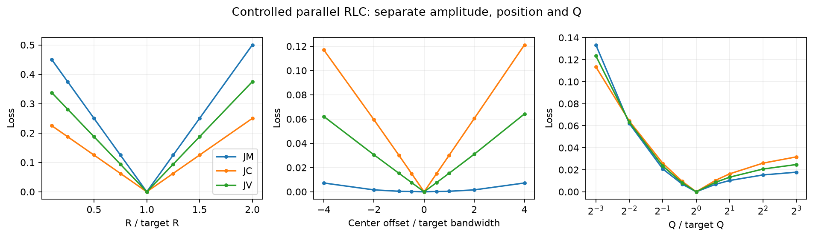
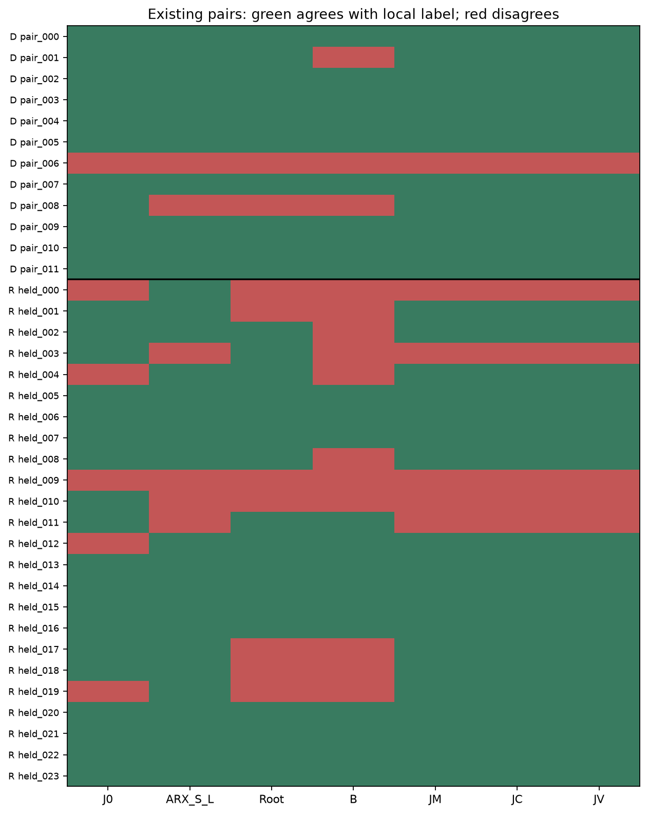
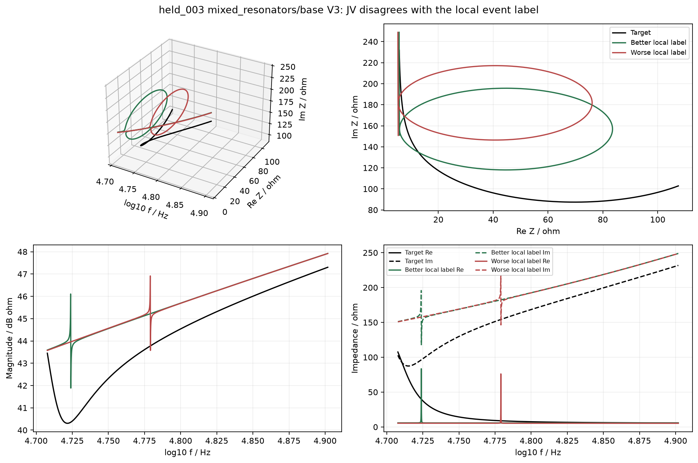
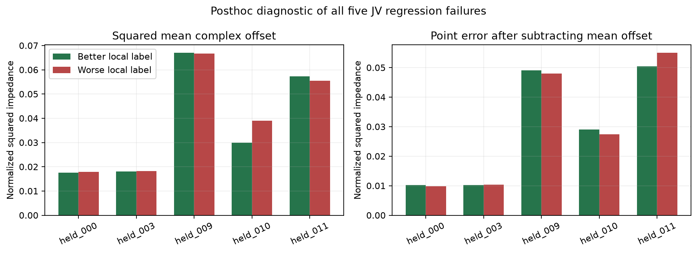
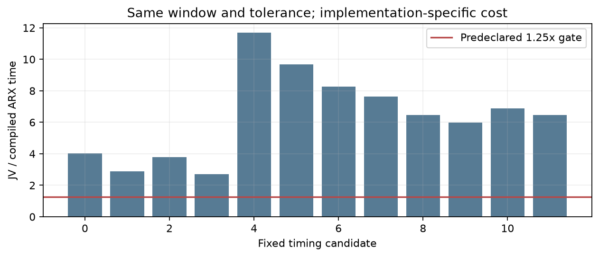

# 复阻抗方向变化总量与频率累计分布：开发实验报告

日期：2026年10月17日。状态：评分、数值复核、结果回收及人工图形检查完成；未启动新优化。

## 摘要

本轮测试复阻抗轨迹在四个方向上的正、负变化总量JM、沿频率的累计分布差JC，以及预先固定的唯一主候选JV=(JM+JC)/2。共684个受控物理设置、12对既有开发样本和24对旧候选回归样本，合计756项任务、2124个候选—窗口记录，全部通过折线与解析导数两种计算的数值检查。

JV在开发集11/12、旧24对回归19/24，修复两个明确P3反例，并在受控谐振中心偏移测试中保持所检查方向的单调响应。但已有失真类只有5/8，低于预定6/8；与原ARX相比，旧24对中未修复其错误，反而新增一例错误。当前向量化Python实现的配对耗时比中位数为6.46，未达1.25倍准入线。**本候选未获准进入长程优化。**

新增判断有两点：变化总量与频率分布的分工能够修复此前部分面积、二阶差分反例，但本轮三个消融在36对样本上的方向完全相同，没有证明累计分布带来额外判别作用；此外，旧“完整事件”标签只约束位置、高度和3 dB宽度，不能保证整段三维轨迹恢复。后者不用于追改标签或宣布新指标通过。

## 1. 预先固定的范围

执行依据为[实验方案](../../docs/复轨迹方向变化分布_实验方案_20261017.md)。主公式、四个方向、1:1权重、参数任务表及74项源代码/输入哈希在评分前冻结。

受控部分沿用单并联RLC的648个R/f0/Q组合及36个额外串联叠加支路设置。真参数为R=3000 Ω、f0=25 kHz、Q=2000，采用能独立指定这三个量的参数化。候选参数均为物理电路，不能把叠加支路解释为只增加一个峰、背景完全不变。

实际候选沿用上轮12对开发样本与24对旧候选。三个目标是Case1、混合网络原条件及LC条件。**24对已经参与过研究，本轮全部称回归样本，不再称新留出或独立验证。**局部好坏标签与双方MAG/PHA差不超过5%的原限制保留；未删除不利样本，未按新分数选样。

## 2. 指标及其可解释范围

令窗口内t为归一化对数频率，z(t)=Z/S*，S*仅由目标确定。固定θ=0、π/4、π/2、3π/4，对uθ=Re(exp(-jθ)z)分拆正、负变化：

\[
d\mu_{\theta,+}=\max(u'_\theta,0)dt,\qquad d\mu_{\theta,-}=\max(-u'_\theta,0)dt.
\]

记M=μ([0,1])，C(t)=μ([0,t])；Dθ为该方向目标正负总变化，并用目标方向总量RMS的0.1倍及10^-4设下限。

\[
J_M=\tfrac18\sum_{\theta,\pm}|M-M^*|/D_\theta,\quad
J_C=\tfrac18\sum_{\theta,\pm}\int_0^1|C-C^*|dt/D_\theta,\quad
J_V=(J_M+J_C)/2.
\]

JM衡量轨迹向各方向走过多少；JC保留这些变化发生的频率。单并联RLC在完整正频率半轴上的复轨迹是直径R的圆，Q改变沿频率的推进过程；这为分工提供明确例子。有限窗口会截断轨迹，因而实际JM仍随Q和位置改变，不能声称严格将高度与宽度解耦。复杂网络也不能从一个端口峰谷直接认定唯一支路或唯一模式。

相同总量时，非负一维测度累计分布的L1距离具有W1解释；本式允许不等总量，未作候选自身概率归一化，故整体不称标准Wasserstein距离。它也不是完整三维曲线的旋转不变距离。频率标签保留，但四个投影可能丢失关系；常量复平移不被该量识别，需要主目标约束。

## 3. 数值可靠性与受控响应

主计算按目标与候选模态锚点生成折线，将各投影的正负增量累计，逐线段精确积分累计差的绝对值。所有样本均完成64、128、256细分并通过原绝对10^-4、相对10^-3的门槛，无需启用预定512、1024上限。

独立计算采用解析电路导数，显式加入投影导数零点，以16、32阶Gauss积分计算正负变化和累计差。全部窗口的两阶结果、折线结果及目标尺度一致。合成例子通过往返分拆、常量平移不变性与等总量紧支撑平移测试。

保持R、Q不变，正向中心偏移结果为：

|中心偏移/目标带宽|JM|JC|JV|
|---|---|---|---|
|0|0.000000|0.000000|0.000000|
|0.5|0.000183|0.015107|0.007645|
|1|0.000439|0.030200|0.015320|
|2|0.001568|0.060452|0.031010|
|4|0.007246|0.121129|0.064188|

在这些位置上JV随偏移增大，未重复B在1到4带宽时下降的现象。负偏移切片也保留于完整数据和图中。该结果只覆盖规定有限范围，不证明所有形变、不同总量或任意窗口下均单调，更不证明优化目标全局凸。

图中JM对Q仍有响应，主要提示有限窗口不能保留完整圆的全部变化；不能把图中的三条曲线解释成三个独立物理参数估计器。648个相关设置也不是648次独立统计重复。

## 4. 旧样本回归结果

“正确”仅指方向与冻结的局部事件标签一致，不能直接当作通用结构识别准确率。

|指标|开发正确/12|旧24对正确|未匹配/8|已有失真/8|额外结构/8|
|---|---|---|---|---|---|
|J0|11|19|6|5|8|
|ARX_S_L|10|20|7|5|8|
|Local_ARX|8|15|2|6|7|
|Root|10|17|3|6|8|
|B|9|13|1|4|8|
|JM|11|19|6|5|8|
|JC|11|19|6|5|8|
|JV|11|19|6|5|8|

JV的开发额外结构为5/6，两个明确P3反例均修复。旧24对总数达18对线，但已有失真仅5/8，因此仍失败。Case1为8/8，混合原条件6/8、LC条件5/8；原ARX分别8/8、7/8、5/8。

原ARX在已有失真类也只有5/8，20/24不意味着它通过本轮所有准入门槛。这里使用它作为固定参照，不把其总数较高解释为最终方法已经合格。

相对J0，JV修复held_004、012、019，又在held_003、010、011反向，合计仍为19/24。这说明二者排序并非相同；相同总数也不能证明等效。相对原ARX，旧24对没有新增修复，并多错held_000。相对Root，修复4对但新错2对，净增2对。

JM、JC、JV在全部36对上的方向完全相同。本轮没有证据表明1:1组合或累计分布在这批实际候选中增加了方向判别能力；不能看消融结果后改权重并把同一批继续称验证。

## 5. 失败集中在哪些结构

五个旧24对失败全部位于混合网络的V3谷窗口：

|失败对|条件|家族|JV正侧/负侧|
|---|---|---|---|
|held_000|mixed_resonators/base|missing_structure|1.2550|
|held_003|mixed_resonators/base|existing_distortion|1.1169|
|held_009|mixed_resonators/lc_reciprocal_8p0|missing_structure|1.0153|
|held_010|mixed_resonators/lc_reciprocal_8p0|existing_distortion|1.2850|
|held_011|mixed_resonators/lc_reciprocal_8p0|existing_distortion|1.0705|

正侧/负侧大于1表示局部标签较好的一侧受到更大惩罚。标签包括两个严格未匹配对和三个已有失真对，不能将五例都归为漏谷。

例如held_003正侧的谷位置偏差0.00235 decade、高度偏差+1.58 dB、3 dB宽度比0.673；负侧分别0.05744 decade、+3.27 dB、1.013。正侧符合旧完整规则，但下图可见双方整段Re/Im和三维轨迹仍明显偏离目标，且有窄的往返过程。**通过事件阈值，不等于恢复整段复轨迹。**宽度与背景、相邻极值的关系也不能仅由一个宽度比说明。

因此，既不能用新指标违背标签证明其一定更差，也不能以标签有限为理由宣布指标有效。当前仍按原门槛判失败，并保留全部曲线、连续量和来源。后续评价体系需要说明：目标谷的位置/高度优先，与整个复轨迹过程相似之间，究竟允许怎样的取舍。

另作事后诊断，将普通复误差精确分成：

\[
\int|z-z^*|^2=|\overline{z-z^*}|^2+\int|z-z^*-\overline{z-z^*}|^2.
\]

五例中有两例（held_000、010），负侧平均复偏置更大，但去均值后的点误差更小。这与导数表示无法约束常量偏置的局限一致，但不能解释其余三例，也不证明该偏置是反向排序的唯一原因。该分解是事后解释，未新增候选或改变评分。

## 6. 成本与复核

在同一服务器上，固定12条真实候选（每目标4条）、相同窗口、相同积分容差，预热后交替测量5轮，JV/原编译ARX_S_L的逐候选中位耗时比的中位数为6.46，95分位为10.58，超过预定1.25倍线。双方均排除独立审计和模型启动；首次调用记录另存。

这里比较的是当前向量化Python折线实现与既有编译ARX，包含实现差异，不是数学复杂度下界；没有证明本表示无法加速。由于方向门槛已经失败，本轮没有再投入原生代码重写以争取准入。

服务器采用32个单线程工作进程，配额32核、60 GiB；评分与自动汇总约4.20秒，不含环境准备、后续计时、回收和本地分析。任务结束后才取得资源采样，不能据该空闲采样宣称运行期利用率，也没有连续CPU核时记录。

本地独立复核72条候选评分全部通过；服务器原生模型与本地Python响应最大相对差2.76×10^-12，72条候选各取至多21个频点的独立节点电路解全部通过双精度检查。684项受控设置与独立R/f0/Q公式最大相对差8.00×10^-12以内。源/输入74项在服务器评分后未变。结果包1,472,776字节、769项归档条目，大小、SHA256及ZIP CRC通过，失败例原样保留。

## 7. 决策与研究问题

JV通过本轮数值检查和所测中心偏移检查，但未通过已有失真类及成本门槛，因此未启动新配对优化、未生成新的60000评价任务、未修改膝点或δ，也没有用JM/JC替代主候选。

|持续问题|当前判断|
|---|---|
|哪类结构反复困难？|混合网络V3谷的整段过程仍与简单事件标签、几何评分发生冲突；Case1本轮8对方向一致，不代表Case1优化已解决。|
|什么条件使其更难？|背景与局部往返过程耦合，有限窗口改变变化总量；位置/高度/宽度标签未描述全部复轨迹。|
|指标能否改善？|修复Root/B若干反例、改善所测错位响应，但旧24对没有超过原ARX，没有新优化收益证据。|
|能否推广、代价是什么？|全部旧目标参与开发；没有新拓扑、实测、噪声或独立优化验证。当前实现成本过高，噪声下正负变化还可能膨胀。|

本轮收缩了后续选择：停止直接扩展JV的优化规模，先明确混合网络谷的三维结构判据，区分窄往返、宽谷过程与背景偏置。评价标准若需修订，必须单独冻结新协议并保留旧结果，不能用修订后的定义挽救本轮通过率。本文不主张MSE理论无解，不主张JV具有已证实的物理因果或方法新颖性。

传输型误差的研究动机可参考[Engquist、Froese、Yang的波形反演论文](https://arxiv.org/abs/1602.01540)及[Yang的分析论文](https://arxiv.org/abs/1902.01226)。这些工作研究其他反演问题，不能作为本指标或阻抗优化有效的证据。

## 8. 数据与复算入口

- [全部表格](ALL_TABLES.md)、[研究判断](FINDINGS.md)、[问题及影响](ISSUES.md)。
- [冻结任务](TASKS.json)、[方向表](DIRECTIONS.csv)、[受控数据](CONTROLLED.csv)、[汇总](SUMMARY.json)。
- [本地独立复核](LOCAL_CHECKS.json)、[成本原记录](BENCHMARK.json)、[事后分解](POSTHOC_ANALYSIS.json)。
- [评分前源/输入哈希](SOURCE_MANIFEST.json)、[回收校验](../../archive/LOCAL_ONLY.md#ref-1f4a590ead54)、[最终状态](REVIEW_STATUS.json)。

本轮未发布网站、未创建监控自动化。服务器本轮计算进程已结束，未执行本实例关机操作。
