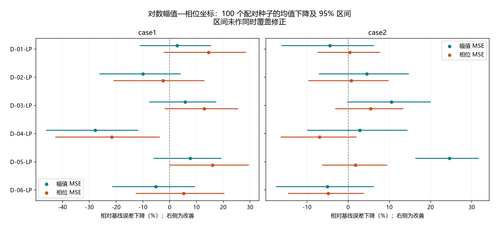

# 三维阻抗曲线指标：两轮正式实验汇总

已检验六种几何方向：全频率对距离、整体坐标变化关系、三平面有向面积、走向与变化快慢、按弧长对应的形状，以及新增的全频率对空间方向差。
本次比较三种坐标：LIN（实部/虚部线性归一化）、ASH（实部/虚部有符号对数式压缩）、LP（对数幅值/主值相位）。全部坐标都包含归一化的对数频率，目标和候选共用目标尺度。
六种方向不等于十六个独立新原理：五类方向各比较三种坐标，方向差在第二轮新增，共十六种具体候选。

两轮共有 3,600 次完整正式运行、189,000,000 次评估。第一轮各 Case 11 组 × 100 seeds；第二轮各 Case 7 组 × 100 seeds。两轮各自重跑基线，不是将重跑当成更多独立种子。
Case I 种群 200 × 300 代；Case II 种群 150 × 300 代；每轮均是原双主目标加单辅助。慢实现曾中止的 302 次完成运行不纳入这些结果。

## 主要结论

**尚未发现一项在两个 Case 都有明确双主目标改善证据的三维辅助指标。** 当前结果不支持只因几何意义容易解释就直接纳入目标集合。

两个 Case 四个误差均值都下降的候选：D-03-LP, D-05-LP。均值方向一致与有统计支持不是同一件事。

## 全部下降比例

正数表示误差下降，负数表示变差；均值下降 = 100 ×（基线均值 − 辅助组均值）/ 基线均值。幅值为 dB² 的 MSE，相位为 rad² 的 MSE，不是幅值或相位本身的下降。

|方向与坐标|Case I 幅值下降|Case I 相位下降|Case II 幅值下降|Case II 相位下降|
|---|---:|---:|---:|---:|
|D-01-ASH 全频率对距离|-7.31%|4.69%|-31.97%|-34.72%|
|D-01-LIN 全频率对距离|-14.15%|-12.85%|-61.82%|-53.91%|
|D-01-LP 全频率对距离|2.77%|14.49%|-4.46%|0.38%|
|D-02-ASH 整体坐标变化关系|10.67%|0.66%|-31.58%|-36.97%|
|D-02-LIN 整体坐标变化关系|-12.26%|-12.58%|-51.53%|-54.48%|
|D-02-LP 整体坐标变化关系|-9.99%|-2.49%|4.51%|0.73%|
|D-03-ASH 三平面有向面积|-12.07%|-12.76%|-54.18%|-49.34%|
|D-03-LIN 三平面有向面积|-10.96%|-12.40%|-30.95%|-20.47%|
|D-03-LP 三平面有向面积|5.79%|12.89%|10.48%|5.48%|
|D-04-ASH 走向与变化快慢|-27.72%|-27.64%|-18.44%|-27.47%|
|D-04-LIN 走向与变化快慢|-23.49%|-14.36%|-41.57%|-38.87%|
|D-04-LP 走向与变化快慢|-27.79%|-21.62%|2.84%|-6.91%|
|D-05-ASH 按弧长对应的形状|3.61%|5.45%|-71.08%|-73.10%|
|D-05-LIN 按弧长对应的形状|-3.81%|-3.82%|-50.24%|-49.42%|
|D-05-LP 按弧长对应的形状|7.63%|15.98%|24.60%|1.79%|
|D-06-LP 全频率对空间方向差|-5.15%|5.24%|-5.03%|-4.84%|

### 当前建议：保留复核候选，不宣称已经筛选成功

- 优先复核 D-05-LP（按弧长对应的形状）：两 Case 的两项均值方向都改善；Case II 幅值下降 24.60%，配对区间 [16.32%, 31.76%]，本轮 Holm p≈0.000140，幅值证据较明确。但是相位下降 1.79% 的区间为 [-6.31%, 9.45%]，尚不确定，Case I 也未获得明确双项支持。
- D-03-LP（三平面有向面积）可作次级复核候选：两个 Case 的两项均值都下降，但四项区间均跨零，证据弱于 D-05-LP 的 Case II 幅值结果。
- 新增 D-06-LP（全频率对空间方向差）目前不推荐：没有在两个 Case 实现双项均值改善。
- 不能把“相位未检出显著变差”说成“证明相位不变或改善”；这需要另行设计非劣性或独立验证，当前没有做。

## 第二轮：哪些均值变化值得说明

- case1 / D-01-LP：幅值下降 2.77%，区间 [-11.15%, 15.44%]；相位下降 14.49%，区间 [-2.32%, 28.50%]；本轮 Holm p = 1 / 1。
- case1 / D-02-LP：幅值下降 -9.99%，区间 [-26.15%, 4.10%]；相位下降 -2.49%，区间 [-20.93%, 13.01%]；本轮 Holm p = 1 / 1。
- case1 / D-03-LP：幅值下降 5.79%，区间 [-7.61%, 17.44%]；相位下降 12.89%，区间 [-1.83%, 25.59%]；本轮 Holm p = 1 / 1。
- case1 / D-04-LP：幅值下降 -27.79%，区间 [-46.16%, -11.76%]；相位下降 -21.62%，区间 [-42.71%, -3.70%]；本轮 Holm p = 0.01866 / 0.5349。
- case1 / D-05-LP：幅值下降 7.63%，区间 [-6.05%, 19.31%]；相位下降 15.98%，区间 [-0.06%, 29.58%]；本轮 Holm p = 1 / 1。
- case1 / D-06-LP：幅值下降 -5.15%，区间 [-21.43%, 9.43%]；相位下降 5.24%，区间 [-12.67%, 20.38%]；本轮 Holm p = 1 / 1。
- case2 / D-01-LP：幅值下降 -4.46%，区间 [-16.20%, 6.32%]；相位下降 0.38%，区间 [-7.42%, 7.77%]；本轮 Holm p = 1 / 1。
- case2 / D-02-LP：幅值下降 4.51%，区间 [-7.13%, 14.75%]；相位下降 0.73%，区间 [-9.69%, 9.85%]；本轮 Holm p = 1 / 1。
- case2 / D-03-LP：幅值下降 10.48%，区间 [-0.24%, 20.08%]；相位下降 5.48%，区间 [-3.15%, 13.38%]；本轮 Holm p = 1 / 1。
- case2 / D-04-LP：幅值下降 2.84%，区间 [-9.96%, 14.39%]；相位下降 -6.91%，区间 [-16.36%, 2.01%]；本轮 Holm p = 1 / 1。
- case2 / D-05-LP：幅值下降 24.60%，区间 [16.32%, 31.76%]；相位下降 1.79%，区间 [-6.31%, 9.45%]；本轮 Holm p = 0.0001404 / 1。
- case2 / D-06-LP：幅值下降 -5.03%，区间 [-17.52%, 6.21%]；相位下降 -4.84%，区间 [-14.59%, 3.88%]；本轮 Holm p = 1 / 1。

各区间由 10,000 次配对种子重采样得到，反映优化随机性；未作同时覆盖修正。各轮检验分别作 Holm 修正（40 项、24 项），不是对历轮探索的全部选择偏差作了校正。第二轮是在第一轮负结果后提出，不是独立数据确认。

## 不能忽略的问题

- 大多数几何量不能唯一决定曲线。距离、协方差、面积、方向差等也可能忽略整体平移；原幅值、相位目标不可去掉。
- 直接对 LP 坐标作相同频率逐点距离平均会退化成原两误差的固定加权和，本轮没有将它当成新指标。
- Case II 在 16 MHz 有一个相位 107°、负实部的测量点，正参数被动 RLC 不能精确复现；最大相邻主值相位跳变为 184.9°。这是一项可行域限制，不足以证明实验变差的原因，也不能据此认定测量错误。原始全部 201 点保留，没有删点、截相位或展开相位来改善成绩。
- 单辅助不确定或变差时，不直接以“多加几个”作为改进理由；双、三辅助组合仍需要另行冻结与正式对照。

对上述可行域限制，当前 Case II 每个并联块的导纳实部为 $a_k=1/R_{2k}+R_{2k-1}/[R_{2k-1}^2+(\omega L_k)^2]>0$；若导纳为 $a_k+jb_k$，阻抗实部为 $a_k/(a_k^2+b_k^2)>0$。三个块串联再加 $R_7>0$，总实部严格为正。这个论证只说明无法精确复现负实部点，不证明需要删掉它或它就是全部恶化的原因。

## 完整预算与数值核验

第二轮初版的全点对方向差因临时数组开销慢，停止时已完成 302 次，所有文件保留但不纳入结果。更高效的 native_v2 使用同一公式、全部点对，软件检查在两个 Case 的完整初始种群上与原 NumPy 公式逐位相同；随后从头跑完全部 1,400 次正式运行。没有用原中途结果判断候选效果或改变数学定义。
两轮都通过服务器完整代数/评估数、配对初始化、源代码与最终完整种群审计；原始包下载 hash 一致，全部最终个体用独立公式复算。两轮分别检查 385,000 和 245,000 个最终个体；重跑基线与历史全部 100 seeds 完全一致。

- curve3d_objectives_20261003：主误差跨平台最大绝对差 3.55e-12，辅助公式最大绝对差 2.9e-12。
- curve3d_logpolar_native_20261003：主误差跨平台最大绝对差 8.12e-12，辅助公式最大绝对差 3.75e-14。

## 文件

- [第一轮候选表与坐标图](三维阻抗曲线指标候选_20261003.md)
- [第二轮全部公式、原理与限制](../experiments/curve3d_logpolar_native_20261003/README.md)
- [第一轮完整结果](../experiments/curve3d_objectives_20261003/RESULTS.md)
- [第二轮完整结果](../experiments/curve3d_logpolar_native_20261003/RESULTS.md)
- [第二轮数值版本说明](../experiments/curve3d_logpolar_native_20261003/NUMERICAL_VERSION.md)
- 原始包、每代历史、初始种群和最终完整种群分别保存在各轮 `server_run/`。
