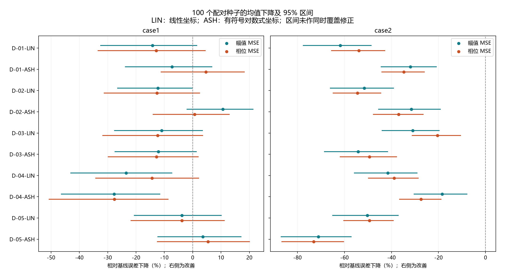

# 三维曲线指标：正式实验总结

已完成 5 个几何方向 × 2 种坐标的检验。两个 Case 各 11 组，每组 100 个配对种子；共 2,200 次运行、115,500,000 次评估。没有缩减为预实验。
Case I 种群 200 × 300 代；Case II 种群 150 × 300 代。原双主目标、原电路、原数据、算子与最后选择方法均保持不变。

## 最主要的判断

**本轮尚未找到一项在两个 Case 都有明确双主目标改善证据的三维辅助指标。** 能解释几何意义，不等于能帮助这套优化算法找到更好的拟合参数。

两个 Case 的幅值、相位四个均值都下降的候选：没有。仅均值方向一致不代表已证明有效。

## 全部结果，不只列改善组

正数表示误差下降，负数表示变差。百分比 = 100 ×（基线均值 − 辅助组均值）/ 基线均值。幅值是 dB² 的 MSE，相位是 rad² 的 MSE，不是阻抗幅值或相位本身减少了多少。
LIN：目标跨度固定的线性坐标；ASH：先做保留正负号的 asinh 压缩，再用目标跨度归一化。两种坐标均包含归一化的对数频率。

|候选|方向|Case I 幅值下降|Case I 相位下降|Case II 幅值下降|Case II 相位下降|
|---|---|---:|---:|---:|---:|
|D-01-LIN|全频率对距离|-14.15%|-12.85%|-61.82%|-53.91%|
|D-01-ASH|全频率对距离|-7.31%|4.69%|-31.97%|-34.72%|
|D-02-LIN|整体坐标变化关系|-12.26%|-12.58%|-51.53%|-54.48%|
|D-02-ASH|整体坐标变化关系|10.67%|0.66%|-31.58%|-36.97%|
|D-03-LIN|三平面有向面积|-10.96%|-12.40%|-30.95%|-20.47%|
|D-03-ASH|三平面有向面积|-12.07%|-12.76%|-54.18%|-49.34%|
|D-04-LIN|走向与变化快慢|-23.49%|-14.36%|-41.57%|-38.87%|
|D-04-ASH|走向与变化快慢|-27.72%|-27.64%|-18.44%|-27.47%|
|D-05-LIN|按弧长对应的形状|-3.81%|-3.82%|-50.24%|-49.42%|
|D-05-ASH|按弧长对应的形状|3.61%|5.45%|-71.08%|-73.10%|

### 两个 Case 分别说明了什么

- Case I 的 D-02-ASH：幅值均值下降 10.67%，相位均值下降 0.66%；两项 95% 区间分别为 [-2.17%, 21.46%]、[-14.07%, 13.09%]，不能当成明确的双项改善。
- Case I 的 D-05-ASH：幅值均值下降 3.61%，相位均值下降 5.45%；两项 95% 区间分别为 [-12.43%, 17.19%]、[-12.62%, 20.16%]，不能当成明确的双项改善。
- Case II 的十项候选：幅值、相位均值全部变差，两项下降率的 95% 区间全部低于零，并且本轮 40 项检验的 Holm 修正后仍支持差异。这批结果不支持将任何一项加入当前辅助目标集合。
- 这不否定把阻抗画成三维曲线用于解释和诊断；本轮不支持的是这些特定公式在当前算法、数据和预算下作为第三目标的效果。

点是 100 个配对种子的均值比例下降，线是配对自助 95% 区间。区间跨零说明均值改善方向还不确定；这些区间未作同时覆盖修正。完整报告同时列出 40 项比较的 Holm 修正 p 值。

## 如何据此筛选

- 不能只看辅助指标自己下降，也不能分别挑两个不同个体各自的最低误差。本表仍按原固定 WSMSE 从最后种群选同一个体。
- 不把单 Case 的改善推广为跨 Case 有效；不把十项中事后最好的坐标当成独立验证。
- 不据此直接上双、三辅助组合：单项尚无支持时，多加目标可能增加搜索负担。组合效果应单独冻结方案、正式检验。
- 指标的数学意义、坐标选择的依据和解释不了的弱点都已写明；没有靠特定转折数量、窗口长度或经验阈值筛点。

## 结果可信度检查

服务器审计：每运行完整 300 代、评估次数、100 个种子的初始化、最后完整种群的目标复算、最终个体选择与源代码指纹均通过。
下载后：完整原始包 SHA256 与服务器一致；代码、配置与启动前冻结版本一致；每个最终种群的指标又以另一套公式实现复算。协方差和弧长使用独立 Gauss 积分，面积用逐平面鞋带公式，距离用完整距离矩阵，而不是重复调用同一个损失函数。
两个 Case 的全部历史 baseline seed 逐项对照结果：case1 最大绝对差 0; case2 最大绝对差 0。

跨 Linux/Windows 复算的主误差最大绝对差为 3.55e-12，最大相对差为 1.29e-13；辅助公式最大绝对差为 2.9e-12。容许精度与实测差异均保留在审计 JSON 中，不更改服务器的实验记录。

统计只反映这批随机优化运行，不涵盖测量噪声、新电路或新数据。前面多轮指标探索也会带来选择偏差，不能靠本轮多重检验完全消除。

## 文件

- [候选表及三维坐标图](三维阻抗曲线指标候选_20261003.md)
- [全部公式、计算步骤和原理出处](../experiments/curve3d_objectives_20261003/README.md)
- [详细结果、区间和检验](../experiments/curve3d_objectives_20261003/RESULTS.md)
- [下载与独立公式复算审计](../experiments/curve3d_objectives_20261003/server_run/download_audit.json)
- 原始 2,200 次运行的初始种群、每代历史、最终完整种群和汇总均在 `experiments/curve3d_objectives_20261003/server_run/raw_results/`；完整包为同目录上一级的 `formal_results.tar.gz`。
