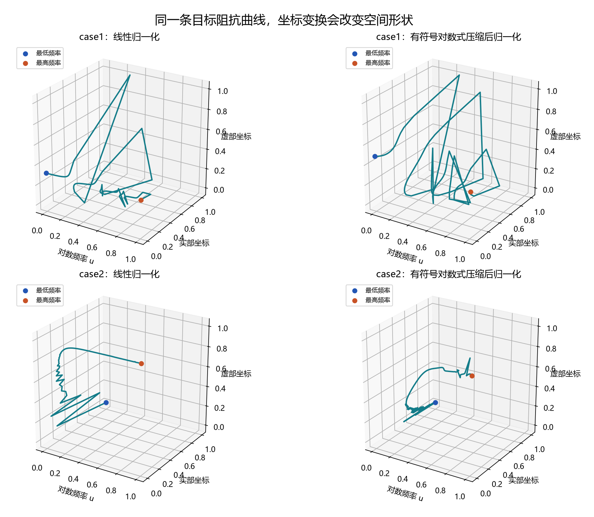

# 三维阻抗曲线：这一轮的候选表

把阻抗看作 $(\log f,\Re Z,\Im Z)$ 曲线。先固定公共坐标，再检验辅助目标是否真的让原幅值、相位两误差下降。目标不是收集更多听起来复杂的名称。

|编号|辅助方向|主要看什么|与局部转折类的区别|需要承认的问题|
|---|---|---|---|---|
|D-01|全频率对距离|任意两个频率位置之间的空间距离是否正确|所有频率对，包含远端关系|不能区分整体平移或镜像|
|D-02|整体坐标变化关系|整条曲线向哪些方向展开，频率/实部/虚部怎样一起变化|全曲线协方差，不挑关键点|相同矩阵可能对应不同细节|
|D-03|三平面有向面积|三个坐标平面上的整体面积和绕行方向|全路径累积，不要求事件数量|反向面积抵消；开放曲线需明确直线闭合约定|
|D-04|走向与变化快慢|全部频段的空间方向和速度是否一致|整段积分，不只在转折点比较|仍是导数指标，可能对微小振荡敏感|
|D-05|按弧长对应的形状|整条曲线走到相同进度时，空间位置是否一致|无固定匹配窗口，无固定重采样数量|局部偏差可能改变后段对应；总长度差约束较弱|

每项测试两种坐标：LIN 为目标跨度固定的线性归一化，ASH 为先做 `asinh(y/S)` 再用目标跨度归一化，$S$ 为目标阻抗幅值中位数。候选不得单独归一化。实部、虚部可以为负或零，不能直接取普通对数。坐标尺度依然是一项建模约定，需要通过两种预先冻结的版本检验，不能说它“天然无主观性”。

图只展示目标曲线在两种坐标下的样子，不展示拟合效果，也不能仅凭图的好看程度挑选坐标。两种坐标都进入同预算正式实验。

没有采用“必须出现几个转折”的指标。曲率、挠率暂缓：高阶导数和近零曲率处理可能需要平滑窗口与阈值，会重新带来难以解释的选择。

完整符号、数学公式、积分算法、弱点、文献来源与冻结预算见 [实验定义](../experiments/curve3d_objectives_20261003/README.md)。

正式实验：两个 Case 各 11 组 × 100 seeds；Case I 种群 200 × 300 代，Case II 种群 150 × 300 代，共 2,200 次运行、115,500,000 次评估。仅做原双主目标加单辅助，先判断单项与坐标的作用，未把多个新辅助目标混在一起。

实验已完成，结果单独放在 [正式实验总结](三维曲线指标正式实验总结_20261003.md)，不在候选公式中混写“有用”的结论。
