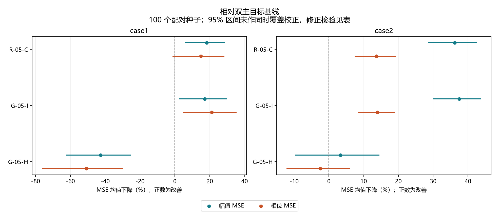
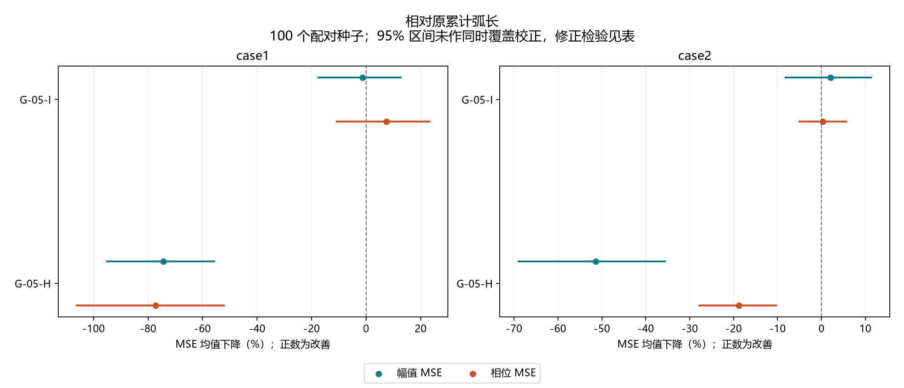
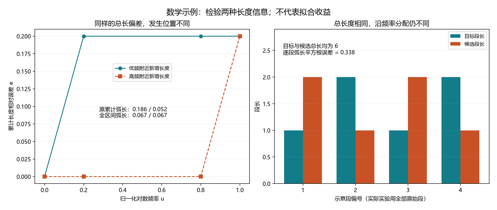

# 全区间弧长和逐段弧长：公式改进与正式实验

本轮完成 800 次完整正式运行、42,000,000 次评估。两个 Case 各 4 组，每组 100 个新配对种子（1100—1199）；原累计弧长作直接对照。所有 140,000 个最终个体、配对初始化、代数、评估数、固定选解以及 20 项修正检验通过独立复算。

## 做了什么

- G-05-I 全区间弧长误差：比较任意两个频率之间沿曲线走过的长度，检验固定从低频端累计的影响。
- G-05-H 逐段弧长平方根误差：用 Hellinger 型差异比较长度在频率上的分配，保留总长信息。它是旧 SRVF 损失中长度部分的改写，未宣称新发明的距离。
- 原 R-05-C 累计弧长、原双主目标、坐标尺度、频点、电路、预算及最终 WSMSE 选择保持一致。

## 结果判断

- R-05-C 对基线：尚未在本轮同时得到两个 Case、两项主误差的明确改善支持。
- G-05-I 对基线：尚未在本轮同时得到两个 Case、两项主误差的明确改善支持。
  对原累计弧长，尚未获得两个 Case、两项主误差均进一步改善的明确支持。
- G-05-H 对基线：尚未在本轮同时得到两个 Case、两项主误差的明确改善支持。
  对原累计弧长，尚未获得两个 Case、两项主误差均进一步改善的明确支持。

本轮筛选决定：

- 原累计弧长 R-05-C 仍作优先候选。Case2 两项误差再次下降，且均有修正检验支持；Case1 均值下降，但本轮两项均未通过预定修正检验，不能写成两个 Case 都已稳定有效。
- 全区间弧长 G-05-I 留作备选，不替换原版。它在 Case2 相对基线有效，但相对原版只多下降约 2.07%／0.28%；Case1 幅值反而变差约 1.37%，相位改善约 7.42%。四项直接比较的区间均跨 0，Holm p 均为 1；这不是等效性证明，也不是升级成功。
- 逐段弧长平方根 G-05-H 退出当前优先候选。在 Case1 相对基线两项明显变差；相对原累计弧长，两个 Case 的两项也均变差且有修正检验支持。公式能解释不代表适合作为辅助优化目标。
- 不据此继续堆叠辅助目标，也不根据本轮结果调整权重、频点或主值相位定义。本轮没有找到明确超过原累计弧长的通用改进。

后续更值得检验的是原累计弧长在新测量、重复测量或有依据的噪声条件下能否保持收益，以及 Case1 为什么对随机初始化更敏感。没有测量噪声依据时，不把随意指定噪声幅度的模拟当成真实性验证。

## 相对本轮基线

|指标|Case1 幅值／相位 MSE 下降|Case2 幅值／相位 MSE 下降|
|---|---:|---:|
|R-05-C 累计弧长|18.20%／14.91%|36.17%／13.70%|
|G-05-I 全区间弧长误差|17.07%／21.23%|37.49%／13.94%|
|G-05-H 逐段弧长平方根误差|-42.65%／-50.83%|3.34%／-2.53%|

## 相对原累计弧长：新公式是否进一步改善

|指标|Case1 幅值／相位 MSE 下降|Case2 幅值／相位 MSE 下降|
|---|---:|---:|
|G-05-I 全区间弧长误差|-1.37%／7.42%|2.07%／0.28%|
|G-05-H 逐段弧长平方根误差|-74.38%／-77.27%|-51.44%／-18.80%|

百分比为 100 次运行的 MSE 均值比例下降，正数改善、负数变差。两个主误差来自同一个最终选中解；区间和检验分别报告，未显著不表示等效。

下降比例为 100 ×（比较组 MSE 均值 − 本组 MSE 均值）／比较组 MSE 均值。配对 bootstrap 区间针对均值比例，Wilcoxon 针对配对差值的秩，且后者进行了 20 项 Holm 修正；因此未修正区间不跨 0 与修正检验未通过可以同时出现，不能择其一宣布成功。

## 区间和修正检验

|Case|指标|比较对象|幅值下降 95% 区间|相位下降 95% 区间|幅值／相位 Holm p|
|---|---|---|---|---|---|
|case1|R-05-C|基线|[5.95%, 28.66%]|[-1.33%, 28.47%]|0.157913／0.699834|
|case1|G-05-I|基线|[2.45%, 30.06%]|[4.47%, 35.47%]|0.72716／0.392043|
|case1|G-05-H|基线|[-62.58%, -25.27%]|[-76.39%, -29.54%]|1.08704e-05／5.70952e-05|
|case2|R-05-C|基线|[28.43%, 42.66%]|[7.41%, 19.20%]|2.52924e-08／0.0002576|
|case2|G-05-I|基线|[29.96%, 43.85%]|[8.43%, 19.02%]|1.46691e-07／0.00408019|
|case2|G-05-H|基线|[-9.79%, 14.57%]|[-12.22%, 6.03%]|1／1|
|case1|G-05-I|R-05-C|[-17.78%, 12.99%]|[-11.02%, 23.46%]|1／1|
|case1|G-05-H|R-05-C|[-95.41%, -55.43%]|[-106.53%, -51.82%]|1.59687e-10／6.57127e-08|
|case2|G-05-I|R-05-C|[-8.34%, 11.49%]|[-5.25%, 5.81%]|1／1|
|case2|G-05-H|R-05-C|[-69.17%, -35.39%]|[-28.02%, -10.14%]|2.10926e-08／0.00415417|

## 如何解释

两种改法均有可直接推导的数学意义。全区间误差相当于把累计长度误差减去其频率平均值后再衡量波动，并非额外独立的物理约束；这也可能减弱对端点附近长度偏差的关注。逐段平方根误差没有累计后的正负抵消，但更直接依赖相邻点变化，不能未经实验就称抗噪。
逐段平方根误差使用 Hellinger 的平方根密度表示，见 [Liero、Mielke、Savaré 原文第 2 节](https://arxiv.org/pdf/1509.00068)。与 [SRV 原始表示](https://pubmed.ncbi.nlm.nih.gov/20921581/) 的长度／方向分解在冻结公式中逐项推导；外层平方根也会影响 NSGA-II 拥挤距离，不能把新旧效果差异完全归因于去掉方向项。
当前结果仍基于原两条目标曲线。频率采样、噪声、Case2 主值相位跳变和模型可行域限制仍在；同一数据上新种子不等于新测量验证，跨轮探索选择偏差也没有被本轮 Holm 校正全部消除。

## 公式和文件

- [详细公式、推导、局限与运行前冻结方案](../experiments/curve3d_interval_20261003/README.md)
- [完整结果与检验](../experiments/curve3d_interval_20261003/RESULTS.md)
- [独立复算审计](../experiments/curve3d_interval_20261003/server_run/download_audit.json)

