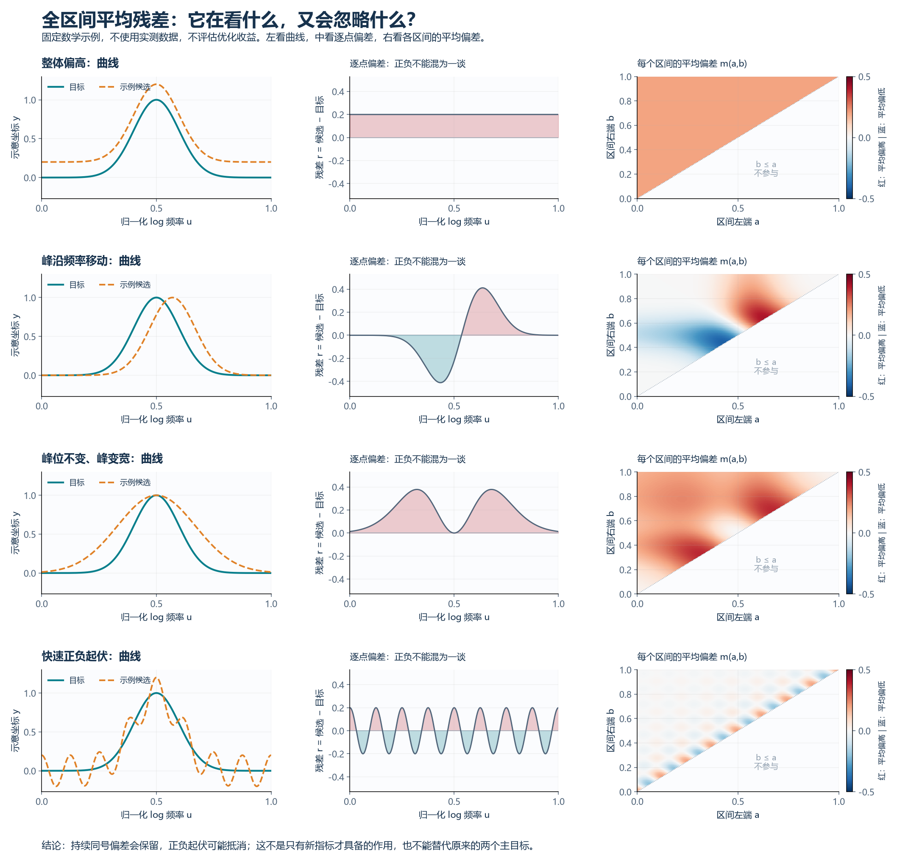

# 全区间平均残差：图解与旧指标对比

2026-10-04。完成当前计划前两步：固定数学示例图解、与已有公式的直接比较。没有连接服务器，没有读入实测曲线做评分，没有运行拟合或随机扰动实验；没有实现最终 T-01 评分器及求积收敛测试。

易读版：[图解页面](../archive/LOCAL_ONLY.md#ref-3c7ee704c9fd)。

## 1. 先给判断

T-01 确实不是 MSE、G-01 或 G-02 的简单改名，但它仍属于累计残差类，**尚未发现只有它才能解决的关键缺口**。

它的具体作用是：检查每个连续频段平均偏高或偏低多少。与累计弧长相比，它能看到整体平移；但 MSE 和旧累计残差本来就能看到。与旧累计残差相比，它先除以频段宽度，再汇总全部区间，减少了短频段被积分宽度压低的影响；这不等于更重视大范围走势。

**当前决定：只保留为待验证的累计残差变体，不把它升级为“已经找到的整体趋势指标”，不继续堆叠其他新指标。** 是否值得增加一个辅助目标，目前仍无答案。

## 2. 四种固定数学示例

每一行从左到右：目标与示例候选、带符号残差、各个区间的平均残差。右图横轴是左端点 $a$，纵轴是右端点 $b$，只有 $a<b$ 的半边有意义。红为平均偏高，蓝为平均偏低；颜色表示区间平均，不是最后的 T-01 得分。四图使用同一色标。

令 $u\in[0,1]$ 为归一化 log 频率，取无量纲示意坐标

$$g(u;c,w)=\exp\left[-\left(\frac{u-c}{w}\right)^2\right],\qquad y^*(u)=g(u;0.5,0.14).$$

为与三维曲线视角对应，可把它嵌入 $p(u)=(u,y(u),u)$：本图只展示会变化的第二坐标，第三坐标两条曲线相同且非恒定。这只是无量纲坐标示例，不是从 Case1/Case2 复阻抗转换出来的曲线，也不声称符合当前电路模型。

|情况|候选曲线|从图上看到了什么|不能因此声称什么|
|---|---|---|---|
|整体偏高|$\widehat y=y^*+0.2$|各区间平均恒为 $+0.2$；累计弧长完全不变|不是只有 T-01 能发现，MSE 和累计残差都可以|
|频率错位|$\widehat y=g(u;0.57,0.14)$|左侧偏低、右侧偏高；同时覆盖两侧的区间存在抵消|T-01 不是“精确频移量”；移峰并未自动对齐|
|同峰位、不同宽度|$\widehat y=g(u;0.5,0.24)$|峰位、峰高相同，但两侧持续偏高|发现峰宽差异不等于优化效果好；峰位本身不充分|
|快速起伏|$\widehat y=y^*+0.2\cos(16\pi u)$|短区间仍有偏差，较长区间正负易抵消|不能把全部起伏叫噪声，不能替代 MSE|

0.2、0.07、0.14、0.24 和 8 个周期仅用于把四种形状画清楚，**不是指标阈值、必需事件数、推荐窗口或经验最优参数**。图像只展示这些确定函数，不据此筛选参数。

绘图中区间平均由解析原函数直接得到：

$$F(u;c,w)=\frac{w\sqrt\pi}{2}\operatorname{erf}\left(\frac{u-c}{w}\right),\qquad F'=g,$$

$$\operatorname{erf}(z)=\frac2{\sqrt\pi}\int_0^z e^{-t^2}dt.$$

四种残差的原函数分别是 $0.2u$、$F(u;0.57,0.14)-F(u;0.5,0.14)$、$F(u;0.5,0.24)-F(u;0.5,0.14)$、$0.2\sin(16\pi u)/(16\pi)$。任意常数在两端相减时消失，因此不必令原函数从零起。

右图的每个像素显示 $m(a,b)=[F_r(b)-F_r(a)]/(b-a)$。这是解析公式的绘图取样，不是新指标最终积分值的数值验证。绘图网格 1201 点及端点图 241 点仅控制显示分辨率；SVG 中曲线为矢量，热图为栅格。

## 3. 为了公平，先统一比较坐标

令向量残差 $r=\widehat y-y^*$，$A(u)=\int_0^u r(t)dt$。只比较公式结构时，使用下列连续、同坐标版本：

$$M=\int_0^1\|r(u)\|^2du,$$

$$C_1=\frac12\int_0^1\left(\|A(u)\|^2+\|A(1)-A(u)\|^2\right)du,$$

$$C_2=\sup_{0\le a<b\le1}\|A(b)-A(a)\|,$$

$$T=L_A^2=2\int_0^1\int_a^1\left\|\frac{A(b)-A(a)}{b-a}\right\|^2db\,da.$$

$M$ 是用于数学比较的连续平方误差，**不是历史两个采样 MSE 的重新计算**。$C_1,C_2$ 是旧 G-01/G-02 的同坐标连续结构对照，**不标作历史原指标值**：原代码使用复相对残差 $\widehat Z/Z^*-1$、原节点梯形积分，G-02 限定节点端点。T-01 原稿则提出目标固定尺度的 dB/相位残差。不能混用后宣称公式有增益。

累计弧长对应的连续形式为

$$B_y(u)=\int_0^u\sqrt{1+\|y'(t)\|^2}dt,\qquad
R=\left[\int_0^1\left(\frac{B_{\widehat y}(u)-B_{y^*}(u)}{B_{y^*}(1)}\right)^2du\right]^{1/2}.$$

离散 R-05-C 实际累加三维折线段长度，并精确积分线性插值后的累计长度残差平方；光滑图例的连续式是结构解释，不冒充历史实现结果。固定平移不改变这些线段长度或连续速度。

代码依据：[G-01/G-02](../experiments/global_objectives_20261003/global_metrics.py)、[R-05-C](../experiments/curve3d_refinement_20261003/global_metrics.py)。

## 4. 正面对比：哪种作用其实已经有了

|要分辨的差异|MSE 型 $M$|累计残差 $C_1,C_2$|累计弧长 $R$|全区间平均残差 $T$|
|---|---|---|---|---|
|整体偏高 $r=c$|能，$M=\|c\|^2$|能，$C_1=\|c\|^2/3$、$C_2=\|c\|$|不能，$R=0$|能，$T=\|c\|^2$；这一点不是新增能力|
|峰沿频率移动|能看到固定频率误差，不直接输出频移量|能看到累计偏差，但会抵消|可能改变累计长度分布；不唯一对应峰位|能看到区间平均偏差，也会抵消，不直接输出频移量|
|峰位相同、宽度不同|能|能；本例残差同号|通常改变长度分布，但长度并不能唯一确定形状|能；本例两侧持续偏高，不是独占优势|
|快速正负交替|平方后不抵消|先积分，会抵消|依赖导数和背景曲线，通常对起伏敏感，但非普遍严格排序|也抵消；短区间仍参与，不等于只看慢变趋势|
|曲线坐标整体镜像|通常能|非零残差可检出|若两非频率坐标作相同正交反射，可完全相同|非零连续残差可检出；主目标本来已有此能力|

“能检出”只表示该理论误差不为零，不表示比别的指标更强、更有物理意义或更利于优化。

### 4.1 不是改名：解析数值关系确实不同

令 $c\ne0$，$e$ 是单位向量，$k$ 为正整数。以下结果均由积分推导，不来自数值评分或拟合：

|残差|$M$|$C_1$|$C_2$|$T=L_A^2$|
|---|---|---|---|---|
|$ce$|$c^2$|$c^2/3$|$\lvert c\rvert$|$c^2$|
|$\sqrt{12}c(u-1/2)e$|$c^2$|$c^2/10$|$\sqrt3\lvert c\rvert/4$|$c^2/2$|
|$c\cos(2\pi ku)e$|$c^2/2$|$c^2/(8\pi^2k^2)$|$\lvert c\rvert/(\pi k)$|$0<T\le4c^2/(\pi k)$，这里只给上界|

前两行有相同 $M$、不同 $T$，说明 T 不是 MSE 的简单单调改名。它也不只是 $C_1$ 或 $C_2$ 的单调改名：

- 常数残差 $ce$ 与 $\sqrt{40}c(u-1/2)e$ 有相同 $C_1=c^2/3$，但 $T$ 分别为 $c^2$ 与 $5c^2/3$。
- 常数残差 $ce$ 与 $8c(u-1/2)e$ 有相同 $C_2=|c|$，但 $T$ 分别为 $c^2$ 与 $8c^2/3$。

线性残差 $r=b(u-1/2)e$ 的原函数为 $A=b(u^2-u)e/2$，直接得到 $M=b^2/12$、$C_1=b^2/120$、$C_2=|b|/8$、$T=b^2/24$，代入即可复核以上各行。

这只证明三种汇总函数不同，**不证明 T 在 MSE 和累计残差之外补上了一个必须单独优化的约束**。全部方法仍使用同一条残差曲线，没有增加观测数据。

### 4.2 “看所有频段”不等于“更看整体走势”

对同一个区间，$\|A(b)-A(a)\|$ 是偏差的总量；$\|A(b)-A(a)\|/(b-a)$ 是偏差的平均强度。先除以宽度会减少短频段受到的宽度折扣，这是 T 的真实改变。

但 T 的端点对等权意味着区间跨度 $h$ 的密度为 $q(h)=2(1-h)$，平均跨度 $1/3$，并非所有跨度等权，更不是只看长区间。可以说它“不预设单一窗口”，不能说它“没有信息取舍”或“比旧方法更强调全局”。

快速起伏的解析例子说明：旧累计残差和 T 都可能趋近零，而逐点 MSE 不变。不能因为 T 看起来更平滑，就宣称它识别了正确趋势。这里 T 仅给上界，不能拿该上界与 $C_1$ 的精确值比较大小或推出严格衰减速度排名。

### 4.3 累计弧长的盲区，并非一定要靠 T 来补

若 $\widehat y(u)=Qy^*(u)+c$，其中 $Q$ 为正交矩阵，则 $\|\widehat y'\|=\|y^{*\prime}\|$，累计弧长完全相同。整体平移、某些镜像都可能被它忽略。

但原两个主目标仍在惩罚逐点偏差。因而“新指标能发现弧长看不到的差异”不是充分理由；还要解释为何主目标已经知道的差异，换一种汇总后能帮助搜索。这一点要靠将来的正式实验，图示不能代替。

## 5. 筛选后的决定

- 保留 T-01 的详细公式与图解，身份是“累计残差的区间平均变体”；尚未证明有必要加入优化。
- 不把 T-01 称为独立的慢变趋势提取器，不据此否定旧累计弧长的实验结果。
- 不为了使它更像“全局指标”再临时增加长区间阈值或跨度权重；那会引入新的解释负担。
- 不继续扩充 T-02/T-03 组合。若恢复计算，先做 T-01 实现与求积检查，再决定是否值得投入两个 Case 的正式比较；本轮没有执行这些步骤。
- 如果用户主要想要的是“忽略某个尺度以下细节后的大轮廓”，仍需要可解释的尺度依据；现在不能声称这个问题已经解决。

## 6. 交付与复现边界

绘图脚本：[固定数学示例绘图](../scripts/draw_trend_metric_examples_20261004.py)。四幅图均提供 PNG/SVG，另有 PNG 总览；只生成说明资产，不调用实验目标或优化器。

本轮查看并修正了图片边缘裁切，核对图示函数及解析对照公式。未做正式评分实现、非均匀网格求积测试、耗时测试或新实验；历史 PDF/PPT 与实验代码未修改。
