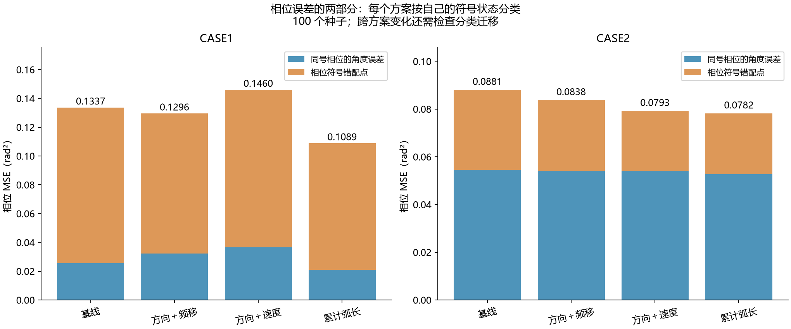
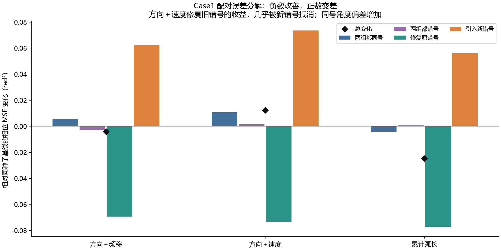
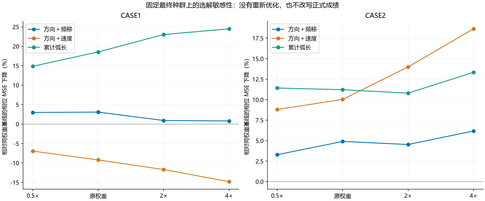
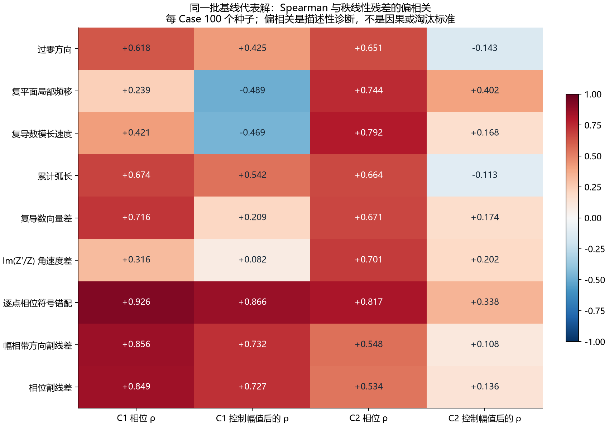

# 相位改善能力探索：从 Case1“过零方向＋速度”的局限推导设计原则

2026-10-05。对既有 1,200 次跨 Case 优化的全部最终种群与共同初始种群作只读诊断，并重建旧 Case1 800 次实验的选中解。计算在指定服务器完成；本轮新增优化次数为 0。主目标、固定选解方式及历史成绩均未修改。

## 1. 本轮能回答到什么程度

现在可以把问题缩小为：原组合对“正确区域是否有正确方向的过零”和“复平面移动速度大小”有约束，但未稳定引导相位角度与相位变化形状接近目标。实际 Case1 输出同时存在事件位置误差与同号角度偏差；本批相对基线的净恶化主要来自后者。仅调整最终相位选解权重不足以消除差距。

这是一条有公式和输出证据支持的设计线索，尚未完整证明 NSGA-II 搜索失败的因果路径。更精确地说，I-03+II-02 在 Case1 的相位收益不稳定：旧独立批次平均改善 2.92%，新批次平均变差 9.22%，区间仍包含零；不能写成每次都损害相位。

最值得继续研究的方向是：在原频率位置上比较带方向的幅相变化，检查能否替换现有速度项；过零位置敏感性作为另一项结构诊断。两者目前都没有新增优化收益证据。已有有效组合保持为对照，不直接扩展成更多目标。

## 2. 先看真实效果与已有组合对照

|方案|旧 Case1 相位下降（100–199）|新 Case1 相位下降（2000–2099）|新 Case1 相位改善种子|
|---|---|---|---|
|方向＋频移|+23.63%|+3.08%|49/100|
|方向＋速度|+2.92%|-9.22%|46/100|
|累计弧长|本旧批次未运行|+18.55%|57/100|

新批次累计弧长相对方向＋速度的相位均值改善 25.43%，在原 60 项 Holm 校正下有支持；方向＋频移相对基线本轮只有 3.08% 均值改善，不能继续当作稳定相位冠军。累计弧长相对基线的本轮相位分量也未通过该 60 项校正。本文事后 bootstrap 区间只用于描述，不覆盖或替换原正式推断。

### 2.1 旧八组实验给出的补充证据

|加入速度项的对照|相位误差均值变化（正数变差）|旧报告配对差值 95% 区间，rad²|
|---|---|---|
|基线 → 速度|+0.60%|[-0.02135, +0.02265]|
|方向 → 方向＋速度|+11.02%|[-0.00680, +0.03580]|
|频移 → 频移＋速度|+5.49%|[-0.01366, +0.02698]|
|方向＋频移 → 方向＋频移＋速度|+18.79%|[-0.00120, +0.04386]|

四种背景下加入速度项的相位均值方向均不利，但这些区间都跨零，只能称一致的探索线索。组合增加也改变目标维数；不能把全部变化归因于速度公式。新批次方向＋频移与方向＋速度均为四目标，提供了目标数量相同的对照。

## 3. 公式到底看到了什么、遗漏了什么

令 $x=\log_{10}f$，$Z=Ae^{i\phi}$，则连续曲线上

$$
\left|Z'(x)\right|=A\sqrt{\left[(\ln A)'(x)\right]^2+\left[\phi'(x)\right]^2}.
$$

II-02 比较 $|Z'|$ 与目标的差，按目标速度及原稳定项归一化。它把阻抗模长、幅值的相对变化率、相位变化率的绝对值混在一起；不直接保留相位变化的正负，也不规定相位本身的角度。连续恒等式解释信息结构；实际代码对复阻抗作有限差分，不能把有限网格结果直接等同于真实连续导数。

I-03 在由目标过零划分的区域内检查“是否至少存在一个方向正确的过零”。区域内移动过零位置时可以保持零损失；相位同为正或同为负时，角度偏差也不由此约束。

### 3.1 组合的共同盲区：一个精确反例

对任意实常数 $c$，令 $\widehat{Z}=Z^{\ast}+c$。有

$$
\operatorname{Im}\!\left(\widehat{Z}\right)=\operatorname{Im}\!\left(Z^{\ast}\right),
\qquad \widehat{Z}'=\left(Z^{\ast}\right)'.
$$

因此 I-03 与 II-02 都为零；但通常

$$
\arg\!\left(Z^{\ast}+c\right)\ne\arg\!\left(Z^{\ast}\right).
$$

把速度模长换成复导数向量也无法识别这个常数平移。

Case1 取 $c=\operatorname{median}\!\left|Z^{\ast}\right|\approx4.685\,\Omega$，相位 MSE 为 0.74134 rad²，I-03 为 0，II-02 约为 $8.3\times10^{-19}$。这是曲线空间的解析示意，并不保证能由原六支路电路精确实现。原相位 MSE 仍能识别它，所以这不意味着整个多目标系统把它视为完美解；它证明的是这两个辅助项不会在这个方向提供额外辨别。

实际方向＋速度结果中，用一个实常数解释复残差平方能量的比例中位数只有 0.124%，实际残差并不像全频段的纯实平移。但这是复残差能量比例，低阻抗位置的小变化仍可能产生较大相位变化，不能据此量化或排除它的相位影响。目前只能确认公式盲区，不能把“实部平移”直接宣布为本次失败的主要原因。

## 4. 在真实拟合里，相位改善与辅助项改善脱节在哪里

|Case1 方案|I-03 均值|II-02 均值|相位 MSE 均值|
|---|---|---|---|
|基线|0.16364|0.24575|0.13371|
|方向＋频移|0.12455|0.16593|0.12959|
|方向＋速度|0.13000|0.18348|0.14604|
|累计弧长|0.09455|0.24343|0.10890|

方向＋速度的 II-02 相对基线降低约 25.34%，但相位均值更差；75 个速度损失下降的种子中，33 个相位上升。方向＋频移没有把 II-02 纳入目标，却得到更低的 II-02 均值。累计弧长的 II-02 均值几乎与基线相同，相位均值却更好。当前样本不支持用“速度损失降得更多”充当相位改善的替代判断。

方向＋速度的 32 个代表解 I-03 已为零，残余相位 MSE 中位数为 0.07673 rad²，范围 0.00280–0.18094。区域覆盖全部满足后，仍有连续的相位质量差异。这个子集内过零位置偏差与相位 MSE 的 Spearman 为 0.855，但样本只有 32 个，且按覆盖条件筛选，不能推广成全域结论。Case2 的选中解没有一个满足全部区域，因此该完整覆盖条件下的位置诊断在那里未定义。

位置诊断沿用原过零检测的节点区间中点，以归一化 log 频率 u 的最近同方向、同区域事件距离求平均；只有所有目标区域都有匹配时才定义。它受原网格定位精度限制，本轮没有给缺失事件人为补一个罚分。

### 4.1 错号点很重要，但不能只修错号

|Case1 方案|符号错配频点比例|错号点占总相位误差|同号角度误差贡献，rad²|
|---|---|---|---|
|基线|1.80%|80.85%|0.025601|
|方向＋频移|1.81%|75.13%|0.032222|
|方向＋速度|2.11%|74.87%|0.036699|
|累计弧长|1.42%|80.67%|0.021046|

基线只有约 1.8% 的频点发生相位符号错配，却贡献约 80.85% 的相位误差，说明原 180 点网格上的少量陡峭过渡位置很重要。这里的“错号”按相位正负/电抗正负判断，不等同于主值相位跨 ±π 分支。Case1 的被动正实部曲线也能出现接近 +90° 到 −90° 的陡变。

|方案|两组都同号|两组都错号|修复旧错号|引入新错号|净变化|
|---|---|---|---|---|---|
|方向＋频移|+0.005801|-0.003037|-0.069378|+0.062492|-0.004121|
|方向＋速度|+0.010658|+0.001407|-0.073214|+0.073478|+0.012329|
|累计弧长|-0.004280|+0.000581|-0.077097|+0.055988|-0.024808|

以上对同种子、同频点作精确划分，各列相加等于总相位 MSE 差。方向＋速度修复旧错号的 −0.073214 收益，几乎被引入新错号的 +0.073478 抵消；两组都同号的 +0.010658 占净增加 +0.012329 的约 86.44%。这是该批均值的描述性分解，不是 86.44% 的因果归因，也不是跨种子不确定性已被消除。

旧独立批次也出现了同号角度误差上升：基线 0.032279、方向＋速度 0.039648 rad²；当时错号误差下降较多，抵消后总相位仍小幅改善。方向＋频移旧批次两部分均下降，当前批次同号部分也上升。由此得到的设计要求应覆盖位置与角度两类缺陷，不能仅从哪一批均值最好推断原因。

## 5. 是选解权重的问题，还是种群中缺少好解

保持每组最终种群固定，将所有组的 WSMSE 相位权重同时改为原值的 0.5、1、2、4 倍。每个权重都与采用相同权重的基线比较，不能只给候选加权。

|Case1 方案|0.5 倍|原权重|2 倍|4 倍|
|---|---|---|---|---|
|方向＋频移|+2.99%|+3.08%|+0.92%|+0.80%|
|方向＋速度|-6.94%|-9.22%|-11.69%|-14.80%|
|累计弧长|+14.87%|+18.55%|+23.02%|+24.49%|

|Case|方案|各次种群最低相位的均值下降|探索性配对 95% 区间|有支配基线的点却选出更差相位的种子|
|---|---|---|---|---|
|case1|方向＋频移|-6.71%|[-27.14%, +9.93%]|7|
|case1|方向＋速度|-22.64%|[-46.53%, -2.42%]|3|
|case1|累计弧长|+27.07%|[+13.85%, +38.97%]|3|
|case2|方向＋频移|+3.22%|[-6.01%, +11.42%]|8|
|case2|方向＋速度|+6.79%|[-0.36%, +13.92%]|19|
|case2|累计弧长|+13.46%|[+6.64%, +19.83%]|8|

最低相位不施加幅值限制，只是查看种群有没有相位较好的点，不能拿它当正式选解成绩。Case1 方向＋速度在 54 个选中相位更差的种子中，仅 3 个具有“幅值不差且相位不差于基线”的可选点却未选中。权重检查和种群最低相位共同提示：当前差距不只是固定 WSMSE 的选择问题；仍不能据此排除随机性、预算或进化过程中的折衷。

另以每个种子基线选中解的幅值 MSE 为共同上限，比较该上限内两组种群的最低相位。Case1 方向＋速度有可行点的种子为 59/100，方向＋频移为 66/100，累计弧长为 57/100。在各自可行子集上它们均有相位均值收益，但这些子集不同且条件由输出决定，不能用 40.82%、43.76%、57.85% 排名，也不能忽略无可行点的运行。完整逐种子表保留在 front.csv。

### 5.1 两个过于简单的解释没有得到支持

- “辅助目标越多，非支配点越多，所以相位变差”：Case1 累计弧长的完整非支配比例约 85.01%，高于方向＋速度的 58.38%，相位反而更好；方向＋频移也有约 61.20%。前沿比例本身不是失败原因的充分证据。
- “与主目标排序冲突越少就越好”：在共同初始种群的双主目标支配点对中，累计弧长出现反向辅助排序的比例约 53.34%，高于速度的 17.18%，但后期相位表现更好。排序冲突可能保留有用搜索方向，不能直接用该比例淘汰指标。

## 6. 哪类信息更接近相位误差：同样本诊断

以下相关性均在相同基线的 100 个代表解之间计算。偏相关指对指标秩和相位误差秩分别回归幅值误差秩，再相关其残差；它只消除一种线性秩关联，受到选解条件和样本分布影响，不是控制全部混杂后的因果效应。

|诊断/指标|Case1 相位 ρ|Case1 控制幅值后|Case2 相位 ρ|Case2 控制幅值后|
|---|---|---|---|---|
|过零方向|+0.618|+0.425|+0.651|-0.143|
|复平面局部频移|+0.239|-0.489|+0.744|+0.402|
|复导数模长速度|+0.421|-0.469|+0.792|+0.168|
|累计弧长|+0.674|+0.542|+0.664|-0.113|
|复导数向量差|+0.716|+0.209|+0.671|+0.174|
|Im(Z′/Z) 角速度差|+0.316|+0.082|+0.701|+0.202|
|逐点相位符号错配|+0.926|+0.866|+0.817|+0.338|
|幅相带方向割线差|+0.856|+0.732|+0.548|+0.108|
|相位割线差|+0.849|+0.727|+0.534|+0.136|

Case1 速度与幅值误差的相关性为 0.806，与相位为 0.421；控制幅值秩后为 −0.469。累计弧长对应的相位相关为 0.674，偏相关为 +0.542。这支持“速度目前更贴近幅值质量，而弧长在这些后期样本中携带不同的相位排序”的解释。

但是方向＋频移里的频移指标偏相关也为负，而旧组合曾有效；Case2 累计弧长在基线样本的偏相关同样略负，实际优化却有效。因此不能把偏相关为正写成相位有效指标的必要条件。所有量都由同一阻抗曲线计算，所谓互补是搜索表达与排序上的互补，不是创造了新的观测信息。

### 6.1 “保留方向”还需要明确在哪个坐标中计算

将复导数模长差改成复导数向量差后，Case1 基线代表解的相位相关提高到 0.716，偏相关为 0.209；但实部常数平移仍完全不可见。直接用 Im(Z′/Z) 的角速度差，Case1 相位相关只有 0.316，偏相关只有 0.082。给指标冠以“相位速度”名称不足以建立有效性。

追加诊断采用原 log 频率位置 $u_i$、目标幅相范围归一化坐标 $y_i$，直接比较相邻节点的带方向变化：

$$
D_{\mathrm{LP}}=\left[\frac{\sum_i h_i\left\|\frac{y_{i+1}-y_i}{h_i}-\frac{y^{\ast}_{i+1}-y^{\ast}_i}{h_i}\right\|^2}{\sum_i h_i\left\|\frac{y^{\ast}_{i+1}-y^{\ast}_i}{h_i}\right\|^2}\right]^{1/2},
\qquad h_i=u_{i+1}-u_i.
$$

单独保留相位分量得到 $D_\phi$。二者都比较同一个频率区间的变化，不进行自由对齐；平方前保留增减方向。这属于 H1/Sobolev 导数误差一类的坐标变体，与已有 II-06、SRVF 有近邻关系，不把它包装成全新理论。原 II-06 在实虚部空间包含值误差与导数误差；这里仅作幅相空间导数诊断。

在 Case1 基线代表解上，D_LP 的相位相关/偏相关为 0.856/0.732，D_φ 为 0.849/0.727；共同初始种群的相位相关中位数仅为 0.411/0.405，说明后期相关性不能外推成全搜索空间规律。

目标范围归一化后，Case1、Case2 的目标导数平方能量仍分别有 92.51%、93.21% 来自相位轴，因此 D_LP 和 D_φ 的表现十分接近。目标范围归一化并未让导数空间的两轴等权；这部分隐含相位侧重必须写明。

D_φ 对恒定相位偏移不敏感，仍需要原相位 MSE 保留角度锚定。对原相位先作割线，与先对复阻抗差分再计算 Im(Z′/Z)，在这些有限频点上不相等；不能用连续恒等式将两者混为一个实现。Case2 的主值分支跳变还会显著影响割线，本轮没有展开或删点。

还有一个反证：Case2 方向＋速度的相位误差已经改善，但 D_φ 均值从基线约 0.6957 上升到 0.7178。因此“D_φ 下降”同样不是已知的普遍必要条件。以上结果支持把它列为有限、可检验的设计候选，尚未支持直接替换已有有效组合。

## 7. 从这些结果推导怎样寻找一套指标

相位 MSE 本身已经完整描述原采样点的相位误差。辅助目标可能通过改变多目标排序、保留结构或提供更容易搜索的中间特征帮助优化；“更像相位误差”并不自动带来增益。以下是优先检查的设计属性，不是相位改善的数学充要条件。

Case1 的目标由同一个六支路模型生成，已知目标参数在既定边界内，两项误差同时为零在模型中可达。因此本例没有必须接受的模型失配下限；需要研究的是搜索怎样更可靠地到达相位更好的区域。Case2 的实测可达性情况不同，不能将该判断照搬。

|设计关注点|本轮依据|对指标体系的实际帮助|
|---|---|---|
|兼顾过渡位置与同号角度形状|错号点贡献大；本批净恶化约 86% 位于两组都同号点|避免只完善过零覆盖，留下主要角度缺口|
|保留频率对应与变化方向|I-03 区域内位置不敏感；II-02 只保留速度模长|优先研究位置敏感事件描述与带方向变化，而非增加固定事件数|
|控制幅值变化对相位线索的混合|原速度受 |Z|、径向变化与相位变化共同影响|先说明坐标与尺度为何能表达目标缺陷，不能只改名字|
|交代自身不变性与盲区|实平移、恒定相位偏移等可保留部分辅助损失|由原主目标锚定未覆盖部分；不要求每个辅助项单独包办所有误差|
|逐阶段检查排序，不单凭相关系数筛选|弧长初始相关可为负，后期更有用；T-01 高相关也未获益|预筛可排除明显不合理定义，但是否有效仍需优化直接对照|
|组合增量需要单独证明|旧组合加速度后相位均值未改善；新权重调整也没修复|先研究替换一项，避免把更多指标直接堆叠进体系|

### 7.1 当前优先假设：替换速度项的表示

H1：在 Case1 的后期搜索中，原复导数模长损失提供的相位区分不足；同频率的带方向幅相割线误差可能更能约束同号角度形状与陡峭过渡。候选为 D_LP，D_φ 作为分量诊断；不是同时再加两个新目标。

支持证据：本批同号误差分解、两个种子批次的相位割线均值变化，以及统一样本上的相位相关。主要反证/风险：旧损失和新诊断都可能与主目标重复；D_LP 隐含相位占优；Case2 已存在“相位改善而 D_φ 上升”；主值分支与原采样分辨率仍在。

若以后进入最小优化检验，应固定原主目标和 I-03，对照原 II-02 与一个明确的替代定义；保持目标数量、预算、配对种子、固定选解与两 Case 一致，以两项原误差及相对原组合的直接增量判断。当前没有启动该检验，也没有把诊断结果称为新有效组合。

### 7.2 次级假设：位置敏感的过零结构描述

H2：I-03 的区域存在性平台可能隐藏了过渡位置偏差，可研究目标实际事件的位置敏感匹配，保留方向并处理缺失/多余事件。它不需要预设 5 个转折或 10 个过零。

本轮完整覆盖子集的相关性提供了线索，但 Case2 无完整覆盖代表解，现有位置诊断在那里失效。匹配、缺失事件代价、归一化和离散定位都必须先定义清楚，不能暗加经验阈值。由于 Case1 净恶化主要在同号角度，这个方向当前作为结构诊断和后续补充，不应独自承担相位改善任务。

## 8. 解释边界与已完成工作

- 已知：公式丢失哪些信息；实际相位误差落在哪里；辅助项与相位改善何时脱节；固定最终种群中的可选解范围。
- 不能简单归因：实部常数偏移、最终相位权重太低、非支配点比例太高、初始排序冲突太多。它们单独都不足以解释现象。
- 仍未知：具体哪些进化选择/变异路径导致差异，替换指标后是否真正产生增益，所得方案能否推广到其他测量。现有输出和每代选中解不能重建所有祖先关系与淘汰过程。
- 本轮没有新测量，也没有新优化；已有有效组合保留。新增诊断量不是已经筛选通过的正式指标。

## 9. 复现与数据入口

服务器工作目录：`/root/autodl-tmp/phase_mechanism_20261005`。全量诊断在原冻结实验目录之外写入，原始目标复算一致；历史 800 个选中解重建后也与原两项 MSE 一致。所有结果按种子保留，未删除不利运行。

- [第一轮诊断问题与边界](../experiments/phase_mechanism_20261005/ANALYSIS_PLAN.md)
- [看过首轮结果后的追加分析说明](../experiments/phase_mechanism_20261005/FOLLOWUP_NOTE.md)
- [两 Case 诊断总表](../experiments/phase_mechanism_20261005/server_run/results/SUMMARY.json)
- [Case1 逐种子辅助量与误差](../experiments/phase_mechanism_20261005/server_run/results/case1/selected.csv)
- [Case1 最终种群可达性诊断](../experiments/phase_mechanism_20261005/server_run/results/case1/front.csv)
- [Case1 固定种群选解敏感性](../experiments/phase_mechanism_20261005/server_run/results/case1/sensitivity.csv)
- [Case1 四状态分解与新诊断量](../experiments/phase_mechanism_20261005/server_run/followup/case1/followup_rows.csv)
- [Case2 对应结果](../experiments/phase_mechanism_20261005/server_run/followup/case2/followup_rows.csv)
- [旧 Case1 八组同样本重建](../experiments/phase_mechanism_20261005/server_run/historical/historical_diagnostics.csv)
- [前轮指标演变与正式实验总报告](近期研究统一总结_指标演变与验证_20261005.md)

三个下载包 SHA256：
- `results.tar.gz`：`fa6f27a4e823324478ce9bf43be9063d9f4dc3404070ee10f70246d90e777d6d`
- `followup.tar.gz`：`a13d724c67db1ecd1504fdbacc810cfa6f2ed1e6f7e02f705158b913373ad74e`
- `historical.tar.gz`：`80e4589bf80d7b7a25c94ed6bfafca1a5a219fcfad89a45b02a187a3409ac572`

## 附表：两 Case 全部六组的相位描述统计

|Case|方案|相位均值 rad²|均值下降|探索性 95% 区间|相位改善种子|两项同降种子|
|---|---|---|---|---|---|---|
|case1|方向＋频移|0.129587|+3.08%|[-16.60%, +20.18%]|49|44|
|case1|方向＋速度|0.146038|-9.22%|[-29.99%, +8.17%]|46|43|
|case1|累计弧长|0.108901|+18.55%|[+2.25%, +32.94%]|57|44|
|case1|T-01|0.118774|+11.17%|[-8.40%, +26.55%]|59|49|
|case1|G-01-LP|0.126299|+5.54%|[-12.17%, +20.57%]|50|48|
|case2|方向＋频移|0.083780|+4.90%|[-4.63%, +13.26%]|55|49|
|case2|方向＋速度|0.079265|+10.03%|[+3.16%, +16.34%]|51|46|
|case2|累计弧长|0.078222|+11.21%|[+3.97%, +17.62%]|60|55|
|case2|T-01|0.080312|+8.84%|[+0.81%, +15.99%]|60|48|
|case2|G-01-LP|0.081539|+7.45%|[-0.60%, +14.92%]|53|46|
