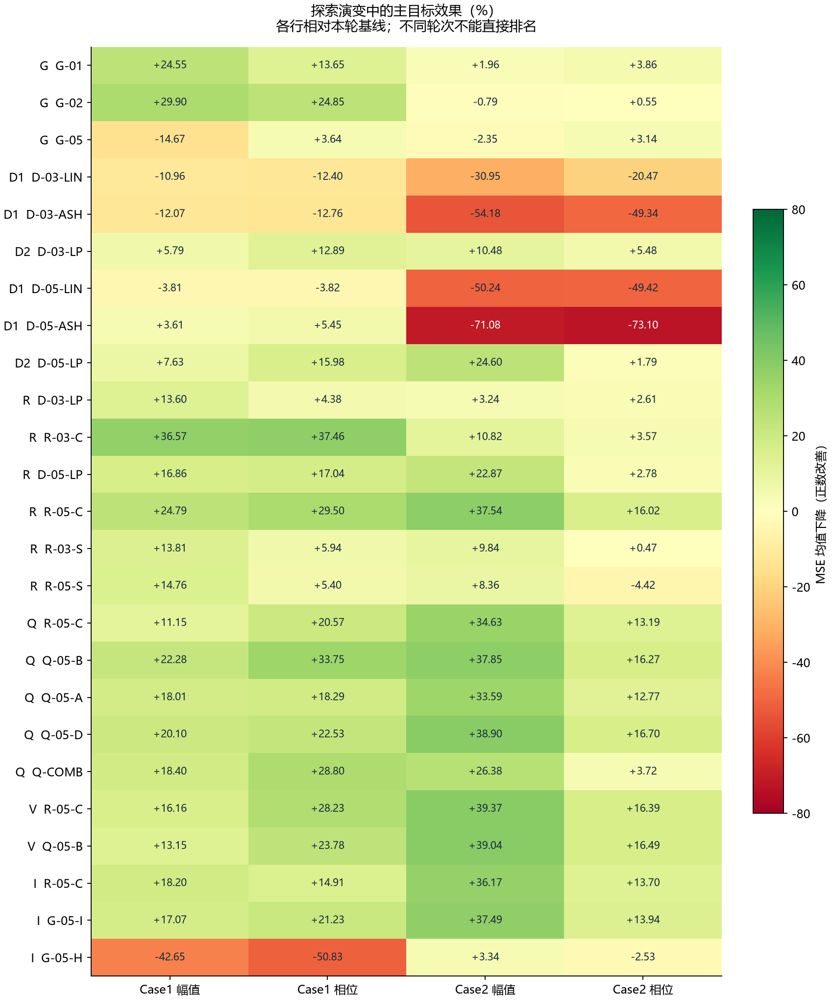
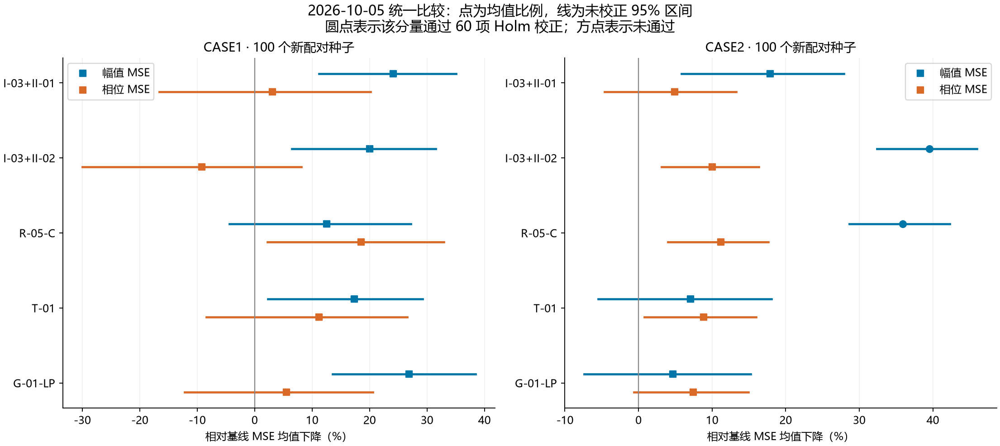
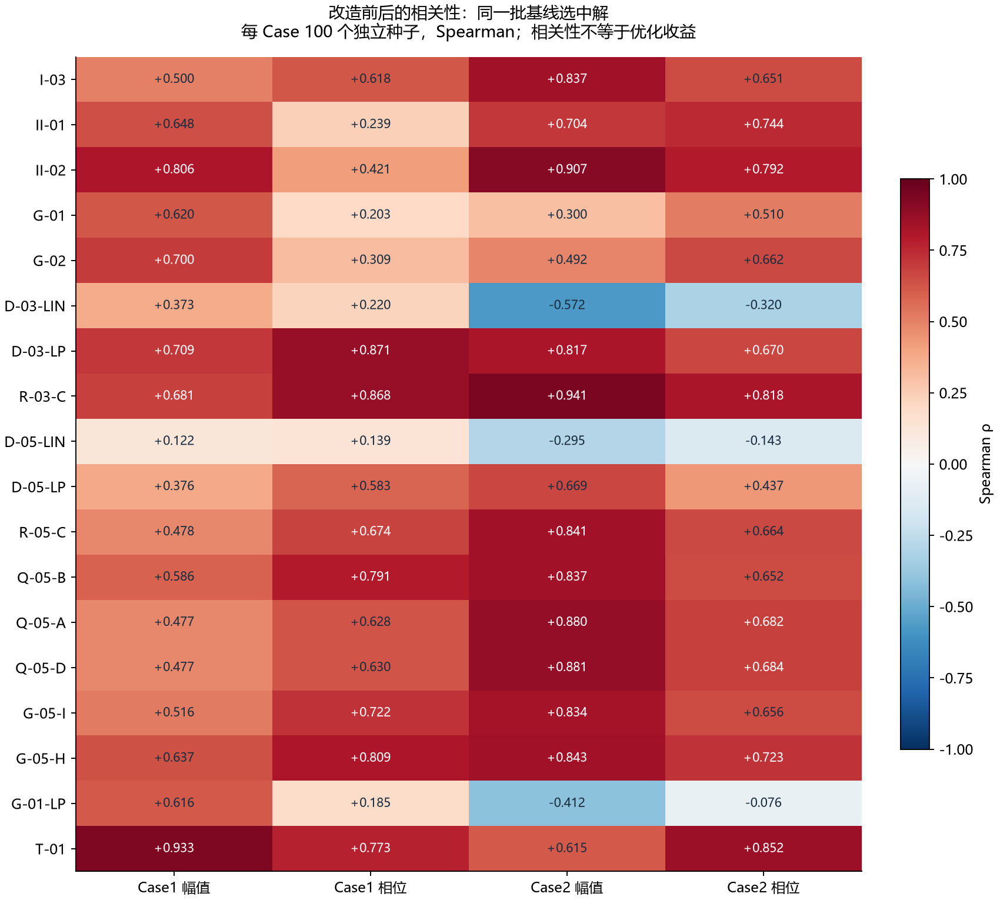
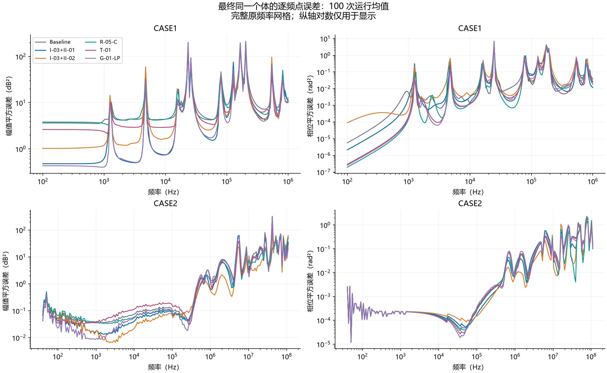
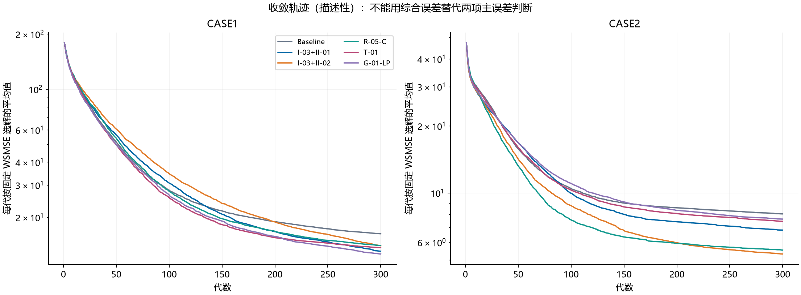

# FEMEIF 近期研究统一总结：指标删选、设计演变、实验效果与相关性

日期：2026-10-05。涵盖旧局部指标筛选、近期七轮全局/三维指标探索、整体走势理论审查，以及本次服务器上的统一比较。所有百分比均以“正数表示 MSE 下降、负数表示变差”呈现。

## 1. 当前最重要的判断

1. 已从当前候选讲稿中移除六项预设事件数量指标；历史公式、代码与结果保留。删除依据是数量门槛缺乏足够解释，并非这六项实验都无效。保留项仍包含检测阈值、稳定化常数与坐标约定，不能统称“完全无主观参数”。
2. 新指标的主要进展是：从实部/虚部几何改为幅值/相位几何，再从最终汇总量改为沿频率的累计过程。累计弧长 R-05-C 是近期几何方向中最值得保留的候选；更多复杂变体没有可靠地超过它。
3. 本次 1,200 次正式运行把两种局部组合、累计弧长、T-01 放在相同种子和预算下比较。Case2 的方向＋速度、累计弧长保持较大均值收益；二者未分出两项主误差都更好的赢家。Case1 的相位表现更依赖种子，先前方向＋频移的优势没有完整重复。
4. T-01 已完成实现、数值核验和首轮正式实验。它并非旧指标改名，但没有明确超过同坐标旧累计残差；Case2 幅值明显落后于局部方向＋速度和累计弧长。当前不建议加入核心目标，也不继续堆叠它与其他辅助项。
5. 本次统一重算了 40 项误差（其中含六项已删指标，仅作审查）的相关性。部分改造提高了误差排序的一致性，但高相关并不保证加入优化有效；G-05-H 与 T-01 都提供了直接反例。

这轮六组全部直接比较共 60 项主误差检验，统一 Holm 校正。没有候选同时在两个 Case 的两个主误差上获得明确改善支持；这与“均值多数下降”是不同结论。历史各轮的检验族大小不同，本报告不把显著性标签直接当作跨轮排名。

## 2. 到底删掉了什么，还剩哪些人为选择

|移除编号|旧定义|处理|
|---|---|---|
|I-01|全局转折数量至少 5 个|从当前目录移除，旧结果保留|
|I-02|目标转折区域覆盖 5-of-6|同上|
|I-04|全局电抗过零至少 10 次|同上|
|I-05|全局转折数量至少 4 个|同上|
|I-07|全局电抗过零至少 8 次|同上|
|II-11|目标转折区域覆盖 4-of-6|同上|

依据是 [2026-10-02 保留/排除清单](../scripts/metric_catalog_selection.json)。当时保留 19 项包含两个主误差、12 项中文 PDF 辅助指标和 5 项英文论文指标。这是展示与候选范围的清理；旧实验代码未被删除，也未把旧统计改写成“删掉后的新实验”。

代码还会把要求事件数按目标实际检测数封顶。Case2 中仅检测到 2 个目标转折，因此 I-01/I-05 等价、I-02/II-11 等价；这反映当前检测配置的结果，不意味着物理系统只有两个转折。I-04 与 I-07 在已有 Case2 单项实验中结果相同，但目标有 9 次过零，其封顶后阈值为 9 和 8，不能仅凭运行结果相同就宣称两个公式代数等价。

|保留项/环节|仍存在的数值选择|应怎样表述|
|---|---|---|
|转折检测|目标角度 95% 分位、候选比例 0.20、事件间隔 4 个索引|检测配置；固定事件数删除后仍需交代|
|I-03 过零方向|目标实际过零、区域边界及离散符号判定|没有预设 8/10 次要求；损失本身不使用转折角度阈值|
|I-06 PTC|邻点差 0.2 dB、γ=0.41|检测/匹配设置|
|II-01 / II-02|目标非零速度中位数的 5% 稳定项|会改变平坦频段权重，不只是机器舍入常数|
|II-03 / II-04|DTW 窗口 4；Soft-DTW 窗口 10、γ=0.10|匹配范围和软化设置|
|II-05 / II-08 / II-09|Hausdorff 95% 分位；局部惩罚权重 0.10|分位/权重选择，尚不能称无参数|
|英文论文指标|SS 的 THk=8、β=0.4、μ=0.5；LFP 阈值 1.6；DTW 60 点|本地冻结实现；不能当成当前 Case2 的物理最优值|
|新几何/累计指标|log 频率、目标范围或标准差尺度、欧氏合并、主值相位|没有指定峰数或过零数，仍有建模约定|
|T-01 数值积分|16 阶 Gauss；预先要求相邻阶相对变化 <1e-6|数值精度设置，经收敛检查；不是趋势宽度或事件门槛|

因此，“删掉数量先验”“保留可解释的建模选择”“核验数值精度”是三个不同层面。不能把所有带数字的定义一概删除，也不能把其余常数藏在实现里。

## 3. 探索路径：先设计什么，后来为什么改

### 3.1 前序局部指标、组合与鲁棒性工作

前序工作先完成旧 18 项辅助指标的单项评估，再做组合筛选、独立种子复验、组成项比较、参数稳定性和模拟噪声/缺失频点验证。当前六项数量先验的删选不抹掉这些历史结果；单项完整表见附表 A。

|前序工作|历史主要结果|本轮如何接续|
|---|---|---|
|Case1 固定局部组合复验|I-03+II-01 幅值/相位下降 30.639%/23.629%，两项调整区间支持；I-03+II-02 相位下降仅 2.924%|两种组合均放入新批次，检验能否重复|
|Case2 组合冠军复验|I-03+II-02 幅值/相位下降 38.374%/12.480%，原检验口径下双项支持|作为工作对照，与累计弧长直接比较|
|Case2 鲁棒性|已测低/中模拟噪声和减半采样下有效；高模拟噪声备选 P-03+P-05；四分之一频点或连续缺段无可靠候选|保留适用边界，本轮不声称完成新测量泛化验证|
|参数分析、可辨识性和对偶讨论|拟合质量、参数集中程度与参数真值恢复是不同问题|不将更低误差或更集中参数写成结构可辨识性证明|
|自动电路生成|已有思路与文献探索|未在本轮扩展为电路拓扑生成实验|

历史精确统计和背景分别见 [Case1 固定组合稳定性](../experiments/case1_dual_validation/server_run/STABILITY.md)、[Case2 迁移及鲁棒性总表](../experiments/CASE2_REMAINING_EXPERIMENTS_SUMMARY.md)、[前次跨对话汇总](跨对话汇总_下一阶段工作_20261004.md)。这些历史成绩不能与本轮新种子百分比直接排成名次。

### 3.2 七轮全局/几何候选

|阶段|问题与方案|正式运行数|种子|
|---|---|---|---|
|G 全局残差候选|G-01 双向累计残差、G-02 最坏连续区间、G-05 相对复误差|800|0–99|
|D1 三维实虚部坐标|距离、协方差、面积、SRVF、弧长对应形状；LIN/ASH 两种坐标|2200|0–99|
|D2 改为幅相坐标|五类几何量改用 dB/相位 LP 坐标，新增全频率对方向差|1400|0–99|
|R 全过程累计与尺度对照|面积/长度改为全过程累计；另以目标标准差替换范围尺度|1400|100–199|
|Q 方向分解与组合|两端对称、分轴总变化、分轴上升/下降、面积＋弧长组合|1400|200–299|
|V 固定少量候选复核|只复核原累计弧长和两端对称累计弧长|600|1000–1099|
|I 全区间与逐段弧长|所有频率区间的弧长误差、逐段弧长平方根误差|800|1100–1199|

上述七轮共 8,600 次完整运行；部分轮次复用了相同种子编号并重跑基线，因此不能称作 8,600 个独立新随机条件。本次新增 1,200 次，使用新种子 2000–2099。早期中止的 302 次慢实现运行不纳入正式效果表。

### 3.3 最早的全局候选并没有全部进入实验

最初提出 G-01 至 G-08：累计残差、最坏区间、变化量 Wasserstein、幅值相关形状、相对复误差、导纳误差、Fréchet 距离、不确定度加权。正式比较的是 G-01、G-02、G-05；其余因丢失方向/总量、坐标与匹配问题或缺少测量不确定度依据等保留在理论候选阶段。不能把“提出过”记为“实验通过”。

### 3.4 三维几何的两次关键改造

第一步：保留 log 频率轴，把另外两轴从 Re/Im 的线性或 asinh 坐标，改为目标尺度固定的 dB 幅值/主值相位。这使部分指标更贴近原主目标的坐标，但它不是新增测量信息，也没有消除尺度选择。

第二步：从终点面积或按归一化弧长对应的位置，改成每个原频率处的累计面积/累计实际长度。尤其 D-05-LP 测的是“按各自归一化弧长对应后的形状”；R-05-C 测的是“走到同一频率时累计长度差多少”，二者不是同一个长度公式的小改名。

### 3.5 后续变体针对的缺口

|新版本|父方案/动机|实际改变|
|---|---|---|
|R-03-C|D-03-LP 仅比较最终面积|逐频率比较累计有向面积，保留中途积累过程|
|R-05-C|D-05-LP 的弧长归一化与重新对应|同频率比较累计实际长度，保留总长差|
|R-03-S / R-05-S|目标范围是否不合适|只换目标标准差尺度；结果不支持普遍升级|
|Q-05-B|只从低频端累计是否偏向一端|前向/反向累计误差等权；总长一致时与原版相同|
|Q-05-A / Q-05-D|长度不保留坐标方向|分轴累计绝对变化；进一步拆成累计上升/下降|
|Q-COMB|面积与长度能否互补|两个辅助目标同时优化；不是一个新的标量损失|
|G-05-I|固定端点导致局部偏差持续传播|比较任意两频率间弧长差，等价于中心化累计误差|
|G-05-H|累计长度可能抵消；SRVF 含方向项|逐段平方根长度差，保留长度部分；外层变换也改变了|
|T-01|连续频段是否持续偏高/偏低|将残差积分除以频段宽度，汇总所有连续区间平均偏差|

分轴上升/下降可由总变化量与起点位移重构，不能称完全独立信息；G-05-I 也是旧累计误差的重新分配。数学解释成立并不要求一定将指标加入优化。

### 3.6 几个关键改造的公式区别

令 $u$ 为归一化 log 频率，$y$ 为按目标范围归一化的 dB 幅值/主值相位坐标，$p=(u,y)$。沿原节点连线的累计长度记为 $\ell(u)$，目标总长记为 $L^*$，令 $e(u)=[\ell(u)-\ell^*(u)]/L^*$。

$$R\text{-}05\text{-}C=\left[\int_0^1e(u)^2\,du\right]^{1/2},\qquad
G\text{-}05\text{-}I=\left[2\int_0^1(e(u)-\bar e)^2\,du\right]^{1/2},\quad\bar e=\int_0^1e(u)\,du.$$

原累计弧长逐频率比较已经走过的长度；全区间版比较两个端点之间的长度差，在该连续定义下等价于中心化累计误差。D-05-LP 则先按各自总弧长归一化，再比较对应位置的形状：改成 R-05-C 同时恢复了原频率对应和总长度信息。

逐段长度为 $d_i$ 时，$G\text{-}05\text{-}H=[\sum_i(\sqrt{d_i}-\sqrt{d_i^*})^2/L^*]^{1/2}$，直接比较逐段长度分配。它与 SRVF 的带方向向量不同，不能称包含完整方向信息。

T-01 的输入改为同频率坐标残差 $r(u)=y(u)-y^*(u)$，令 $A(u)=\int_0^u r(t)dt$：

$$T\text{-}01=\left[2\int_0^1\int_a^1\left\|\frac{A(b)-A(a)}{b-a}\right\|^2\,db\,da\right]^{1/2}.$$

同坐标 G-01-LP 使用 $\frac12\int_0^1[\|A(u)\|^2+\|A(1)-A(u)\|^2]du$ 的原节点梯形离散，无外层开方。T-01 增加区间跨度归一化和所有连续端点对，但所有端点对等权意味着跨度密度为 $2(1-h)$，短区间更多；它没有预先指定峰数，也不等于独立提取慢变趋势。

完整理论定义和解析反例见 [2026-10-04 公式稿](整体走势候选_详细公式与解析反例_20261004.md)；代码/近邻方法审查见 [理论筛选结论](整体走势指标_代码文献审查与筛选结论_20261004.md)。这些文件保持当时的理论阶段记录，本轮新增的实验判断以本报告为准。

## 4. 改造前后对主目标的效果

以下均为“幅值 MSE / 相位 MSE”下降百分比。跨轮表用于追踪过程；判断某个改造是否升级，应优先看同轮对父方案的直接配对比较。

### 4.1 同轮父子直接比较

|轮次/改造|比较对象|Case1|Case2|通过本轮校正的改善分量|
|---|---|---|---|---|
|R R-03-C|D-03-LP|+26.58% / +34.60%|+7.83% / +0.98%|C1 幅值、C1 相位|
|R R-05-C|D-05-LP|+9.53% / +15.02%|+19.01% / +13.62%|C2 幅值、C2 相位|
|R R-03-S|D-03-LP|+0.25% / +1.63%|+6.82% / -2.20%|无明确增量改善|
|R R-05-S|D-05-LP|-2.53% / -14.04%|-18.82% / -7.41%|无明确增量改善|
|Q Q-05-B|R-05-C|+12.53% / +16.58%|+4.92% / +3.55%|无明确增量改善|
|Q Q-05-A|R-05-C|+7.72% / -2.87%|-1.59% / -0.49%|无明确增量改善|
|Q Q-05-D|R-05-C|+10.07% / +2.47%|+6.53% / +4.04%|无明确增量改善|
|Q Q-COMB|R-05-C|+8.16% / +10.36%|-12.61% / -10.91%|无明确增量改善|
|Q Q-COMB|R-03-C|+2.86% / +10.70%|+20.01% / -1.42%|C2 幅值|
|V Q-05-B|R-05-C|-3.58% / -6.20%|-0.55% / +0.13%|无明确增量改善|
|I G-05-I|R-05-C|-1.37% / +7.42%|+2.07% / +0.28%|无明确增量改善|
|I G-05-H|R-05-C|-74.38% / -77.27%|-51.44% / -18.80%|无明确增量改善|

可确认的局部进展是：累计面积相对终点面积在 R 轮 Case1 有双项增益；累计弧长相对归一化弧长对应形状在 R 轮 Case2 有双项增益。它们均未形成跨两个 Case 的通用升级。Q 轮对称弧长看起来更好，但 V 轮新种子复核未重复出明确增量。G-05-H 在 Case1 及相对原累计弧长的直接比较中表现较差，退出优先候选。

### 4.2 原累计弧长跨轮表现

|种子区块|Case1 幅值/相位下降|Case2 幅值/相位下降|证据说明|
|---|---|---|---|
|100–199|+24.79% / +29.50%|+37.54% / +16.02%|Case1 双项支持；Case2 双项支持|
|200–299|+11.15% / +20.57%|+34.63% / +13.19%|Case1 双项支持不足；Case2 双项支持|
|1000–1099|+16.16% / +28.23%|+39.37% / +16.39%|Case1 双项支持不足；Case2 双项支持|
|1100–1199|+18.20% / +14.91%|+36.17% / +13.70%|Case1 双项支持不足；Case2 双项支持|

这些旧轮次保持各自预设统计口径。本次 2000–2099 的新结果见下一节；不把重复使用的旧随机条件合并伪装成更多独立证据。

## 5. 本次服务器实验：六组统一直接比较

两 Case 各 600 次运行，全部成功；共 6,300 万次评价。原主目标、频点、电路、边界、算法和固定选解方式沿用历史设置。T-01 和 G-01-LP 使用相同的目标范围归一化 dB/相位残差；二者汇总公式及外层变换不同。

|方案|Case1 幅值/相位下降|Case2 幅值/相位下降|Case1 Holm p|Case2 Holm p|
|---|---|---|---|---|
|I-03+II-01 方向＋频移|+24.10% / +3.08%|+17.86% / +4.90%|0.1964 / 1|0.1316 / 1|
|I-03+II-02 方向＋速度|+20.00% / -9.22%|+39.56% / +10.03%|1 / 1|2.205e-08 / 1|
|R-05-C 累计弧长|+12.56% / +18.55%|+35.93% / +11.21%|1 / 1|1.751e-07 / 0.2766|
|T-01 全区间平均残差|+17.31% / +11.17%|+7.09% / +8.84%|1 / 1|1 / 1|
|G-01-LP 同坐标累计残差|+26.89% / +5.54%|+4.69% / +7.45%|0.06194 / 1|1 / 1|

### 5.1 直接比较回答了什么

- Case2：累计弧长相对方向＋速度，幅值均值变差约 6.01%，相位均值改善约 1.32%；两项直接比较均未通过校正。当前不能说累计弧长已经替代局部核心组合，也不能反向宣称局部组合全面支配它。
- Case1：累计弧长相对方向＋速度，相位改善约 25.43%，通过本轮校正；幅值均值变差约 9.29%，但没有明确差异支持。这是指标侧重点不同的证据，不能称两项共同升级。
- T-01 相对累计弧长：Case1 幅值改善约 5.43%、相位变差约 9.07%，均未明确；Case2 幅值变差约 45.02%，通过校正，相位约变差 2.67%，未明确。
- T-01 相对方向＋速度：Case2 幅值变差约 53.73%，通过校正；相位没有明确差异。
- T-01 与同坐标 G-01-LP：两个 Case 均无明确的双项增量优势。公式不同已经证明，作为新增辅助目标的价值尚未证明。

这些结论不将不显著解释为等效。本轮 Case2 相位的均值收益依然存在，但 60 项校正后的支持不足；此前较小检验族及其他种子区块的支持继续按原样保留。

### 5.2 T-01 从理论候选走到哪一步

它现在已通过实现和正式实验，但结果支持将其降为研究记录中的备选，而非加入核心优化。它仍只描述连续区间的平均偏差，没有提取独立的慢变趋势。若未来重新考虑，需要新的使用场景或机制理由；本轮没有理由继续增加长区间阈值、调权重或与现有方案堆叠。

## 6. 改造前后的相关系数：统一样本后再看

本节把 40 项损失计算在这次相同的基线样本上：每 Case 的初始种群、基线最终种群各 100 个种子；另外每种子按原 WSMSE 选同一个解，得到每 Case 100 个独立代表解。这里没有改变旧公式，没有为不同指标选择不同代表解。

主表给出代表解之间的 Spearman；Pearson、种群内中位数/四分位数和有效种子数均在附表。相关系数是无量纲关联，不能读成 MSE 降幅。

|指标|Case1 幅值/相位 ρ|Case2 幅值/相位 ρ|
|---|---|---|
|I-03|+0.500 / +0.618|+0.837 / +0.651|
|II-01|+0.648 / +0.239|+0.704 / +0.744|
|II-02|+0.806 / +0.421|+0.907 / +0.792|
|G-01|+0.620 / +0.203|+0.300 / +0.510|
|G-02|+0.700 / +0.309|+0.492 / +0.662|
|D-03-LIN|+0.373 / +0.220|-0.572 / -0.320|
|D-03-LP|+0.709 / +0.871|+0.817 / +0.670|
|R-03-C|+0.681 / +0.868|+0.941 / +0.818|
|D-05-LIN|+0.122 / +0.139|-0.295 / -0.143|
|D-05-LP|+0.376 / +0.583|+0.669 / +0.437|
|R-05-C|+0.478 / +0.674|+0.841 / +0.664|
|Q-05-B|+0.586 / +0.791|+0.837 / +0.652|
|Q-05-A|+0.477 / +0.628|+0.880 / +0.682|
|Q-05-D|+0.477 / +0.630|+0.881 / +0.684|
|G-05-I|+0.516 / +0.722|+0.834 / +0.656|
|G-05-H|+0.637 / +0.809|+0.843 / +0.723|
|G-01-LP|+0.616 / +0.185|-0.412 / -0.076|
|T-01|+0.933 / +0.773|+0.615 / +0.852|

### 6.1 这些相关性怎样解释

- 坐标改造确实改变了误差排序。例如 Case2 的 D-05-LIN 与幅值/相位为负相关，D-05-LP 转为正相关；这说明 LP 表示在当前样本中更贴近主误差。
- 将 D-05-LP 改为 R-05-C 后，两个 Case 的代表解相关性均提高，与累计弧长值得保留的历史结果方向一致，但仍不能据此证明机制。
- G-05-H 的相关性高于原累计弧长的部分分量，而历史优化表现反而更差；T-01 在 Case1 幅值上的 ρ 约 0.933，却没有带来明确的双项优化收益。高相关无法单独用作筛选标准。
- R-03-C 在 Case2 相关性很高，但历史优化收益并不稳定。因此“能评价最终解好坏”和“加入进化后能把搜索引向更好结果”必须分开检验。

### 6.2 为什么最终种群内部会出现负相关

|Case|样本|幅值/相位 Pearson 中位数|幅值/相位 Spearman 中位数|
|---|---|---|---|
|case1|initial|+0.219|+0.282|
|case1|baseline_final|-0.797|-0.985|
|case2|initial|+0.138|+0.215|
|case2|baseline_final|-0.845|-1.000|

双主目标优化后的种群含有明显的幅值—相位权衡。某指标在该种群中与幅值负相关、与相位正相关，并不等于它在所有参数空间都损害幅值。初始种群、基线最终种群和每次最终代表解回答不同问题，不能混成一张无说明的“相关性排名”。

常数指标的相关系数记为“未定义”，不是 0。早期 Case2 围绕一个拟合参考解的 1% 参数扰动实验里，若干事件指标呈常值；该局部结果不能代替这里较广样本上的相关性，更不能证明这些事件指标在整个优化中无效。完整旧扰动结论见 [扰动分析](../experiments/case2_physical_perturbation/results/REPORT.md)。

## 7. 两个 Case 为何不同：事实、线索和解释边界

|Case|频点|频率 Hz|幅值 Ω|当前检测转折数|过零数|最大相邻主值相位差|
|---|---|---|---|---|---|---|
|case1|180|100–1e+06|0.0525971–393.157|6|11|177.67°|
|case2|201|40–1.1e+08|6.26–1.46e+06|2|9|184.90°|

Case1 是同一电路模型生成的合成目标，Case2 是实测目标；模型维数、频率覆盖、预算和尺度也不同。Case1 的六个转折分布较广；Case2 的转折检测集中在前端，不能据此认定局部结构完全被捕获。II-01 是切线投影得到的局部频移近似，不是真正逐个峰匹配。

### 7.1 本次误差主要落在哪些频段

|Case|等宽 log 频率段|原点频率范围 Hz|基线总幅值误差贡献|基线总相位误差贡献|
|---|---|---|---|---|
|case1|1|100–2082|10.29%|0.94%|
|case1|2|2192–4.563e+04|29.38%|30.58%|
|case1|3|4.804e+04–1e+06|60.33%|68.47%|
|case2|1|40–5330|0.33%|0.12%|
|case2|2|5740–7.66e+05|1.43%|1.93%|
|case2|3|8.25e+05–1.1e+08|98.24%|97.95%|

三个频段仅用于描述误差分布，不参与目标计算。Case2 的误差几乎都集中在最高 log 频率三分之一，方向＋速度和累计弧长的主要收益也发生在那里。Case1 的误差更分散；本轮方向＋速度虽降低幅值，但中、高频相位均值上升，抵消了其他收益。这解释了“收益发生在哪里”，尚未证明“为什么该辅助项会改变搜索”。

### 7.2 不能把所有差异归因于相位跳变或一个测量点

Case2 在 16 MHz 存在超出当前正参数被动模型相位域的原点，16–17.2 MHz 的相邻主值相位差为 184.9°。本次它占基线总相位误差约 3.13%；各方案中约 2.44%–6.83%。它不是总误差的大多数，但可能影响其他频段的折衷。Case1 同样存在很陡的相位变化，因此“大相邻差值”本身不能当作唯一原因。没有删除原点、展开相位或更改训练数据来改善这批成绩。

### 7.3 搜索机制仍是待验证解释

更多辅助目标会改变非支配关系；最终前沿占比与收敛曲线已保留，但这些描述不能单独证明“选择压力减弱”是某组变差的原因。需要区分公式侧重点、尺度影响、可行域限制与优化随机性。当前证据足以缩小候选，却不足以给所有失败统一归因。

## 8. 指标体系与下一步决定

|角色|当前安排|依据/边界|
|---|---|---|
|主目标|幅值 MSE、相位 MSE 始终保留|最后仍按两个主误差判断效果|
|Case2 核心工作对照|I-03+II-02|历史多轮与鲁棒性证据较丰富；本轮均值方向保持，相位校正支持不足|
|几何方向优先对照|原 R-05-C 累计弧长|跨轮 Case2 较稳定；本轮未明确替代局部组合，Case1 仍不稳定|
|Case1 局部备选|I-03+II-01|历史有双项支持，本轮相位改善仅 3.08%；不能固化为通用冠军|
|诊断而非默认加目标|频移、DTW、局部最坏误差、频段误差剖面|可解释最终解的不同缺陷；任何新增门控阈值均需另行定义验证|
|降为备选记录|T-01、对称/全区间弧长、分轴变体|当前无明确的跨 Case 增量优势|
|退出优先候选|逐段弧长平方根 G-05-H|历史优化效果差，高相关也不能挽救|
|理论暂缓|T-02、FSV 平滑趋势、能量距离/Wasserstein 等|尚缺优先研究理由或可解释的尺度/应用依据|

后续最有价值的是新阻抗曲线、重复测量或真实噪声依据上的验证，以及针对 Case1 不稳定性的明确机制假设。继续在同两条曲线上改小公式、看均值挑赢家，收益有限。现有 Case2 模拟高噪声备选 P-03+P-05 和缺段/极稀疏下失效的结论继续保留，但不能把某个模拟噪声幅度或采样比例当作所有设备的普适阈值。

## 9. 正确性、复现与文件

本次检查全部 1,200 个初始种群、每次 300 代历史、合计 6,300 万次评价的计数、210,000 个最终个体的目标、非支配索引及固定 WSMSE 选解。生产公式复算最大差约 6.94e-18；独立公式（除 T-01 高阶求积对照）最大绝对差约 8.53e-14；T-01 的 16/32 阶评分最大相对差约 2.08e-8。常数、线性、非均匀网格、倒序/细分和独立自适应积分检查均通过。

完整原始包 94,112,224 字节，下载后 SHA256 与服务器一致，包含 1,200 份运行完成记录和 1,200 个最终种群：`f9ce4219a33222b15c1397d697b34db979894abed56fb8f6f6002b0f8d9add14`。全部实验已结束，服务器没有设置继续运行的自动任务。

- [本轮启动前冻结方案](../experiments/crosscase_consolidation_20261005/PROTOCOL.md)
- [本轮全部直接比较、区间与 60 项校正](../experiments/crosscase_consolidation_20261005/server_run/review_results/analysis/comparisons.csv)
- [七轮历史效果和父子比较全表](research_consolidation_20261005/historical_effects.csv)
- [40 项损失的初始/最终种群 Pearson 与 Spearman](research_consolidation_20261005/correlation_summary.csv)
- [100 个基线代表解的 Pearson 与 Spearman](research_consolidation_20261005/selected_correlations.csv)
- [旧 18 项单辅助描述性结果](research_consolidation_20261005/legacy_single_effects.csv)
- [完整原始结果包](../archive/LOCAL_ONLY.md#ref-0c2936ed2648)
- [轻量代码与分析包](../archive/LOCAL_ONLY.md#ref-e8bfc58fbee0)
- [下载完整性校验](../experiments/crosscase_consolidation_20261005/server_run/download_audit.json)
- [全量复算审计](../experiments/crosscase_consolidation_20261005/server_run/review_results/analysis/COMPLETE.json)

## 附表 A：旧 18 项单辅助结果与删选状态

下表沿用 seeds 0–99 的同一个体 WSMSE 结果，统一换成正数表示下降。这里仅列描述性均值；不补造原报告没有的显著性结论。英文论文原 Case1 部分报告使用最终前沿均值，未混入这张表。

|编号|名称|当前目录|Case1 幅值/相位下降|Case2 幅值/相位下降|
|---|---|---|---|---|
|I-01|全局转折数量：至少5个|移除|+8.29% / +11.36%|+18.31% / +8.11%|
|I-02|目标转折区域覆盖：5-of-6|移除|+3.30% / +6.55%|+11.56% / +5.25%|
|I-03|电抗过零方向一致性|保留|+14.20% / +25.25%|+24.47% / +10.68%|
|I-04|全局电抗过零数量：至少10次|移除|+9.14% / +12.68%|+25.12% / +11.02%|
|I-05|全局转折数量：至少4个|移除|+0.32% / +6.10%|+18.31% / +8.11%|
|I-06|中文PDF峰谷一致性（最近匹配、均值）|保留|+6.09% / +19.29%|+20.89% / +4.35%|
|I-07|全局电抗过零数量：至少8次|移除|-3.22% / +7.14%|+25.12% / +11.02%|
|II-01|局部特征频移误差|保留|+24.61% / +14.79%|+8.08% / +5.78%|
|II-02|转变速度相对误差|保留|+23.55% / +8.24%|+38.17% / +9.52%|
|II-03|窗口约束DTW|保留|-4.48% / +19.20%|-52.37% / -53.08%|
|II-04|Soft-DTW散度|保留|-10.81% / +4.96%|-56.79% / -54.79%|
|II-05|95% Hausdorff距离|保留|+10.98% / +14.35%|-36.43% / -38.78%|
|II-06|Sobolev H1误差|保留|-10.51% / +0.13%|-48.95% / -51.15%|
|II-07|去平移空间形状误差|保留|-45.05% / -18.51%|-45.61% / -45.59%|
|II-08|转折事件弱位置误差|保留|-6.02% / -1.85%|-10.61% / -16.64%|
|II-09|转折存在性与过量事件惩罚|保留|-9.55% / -1.83%|+12.15% / +6.14%|
|II-10|去局部频移后的相对形变|保留|-16.95% / +0.11%|-45.00% / -41.76%|
|II-11|目标转折区域覆盖：4-of-6|移除|-0.85% / +6.50%|+11.56% / +5.25%|

## 附表 B：七轮新指标全部结果（含失败项）

### G 全局残差候选

|指标|含义|Case1 降幅|Case2 降幅|Case1 Holm p|Case2 Holm p|
|---|---|---|---|---|---|
|G-01|双向累积相对偏差|+24.55% / +13.65%|+1.96% / +3.86%|0.0222/1|1/1|
|G-02|最坏连续频段累积偏差|+29.90% / +24.85%|-0.79% / +0.55%|0.000144/0.0222|1/1|
|G-05|复阻抗相对平方误差|-14.67% / +3.64%|-2.35% / +3.14%|0.553/1|1/1|

### D1 三维实虚部坐标

|指标|含义|Case1 降幅|Case2 降幅|Case1 Holm p|Case2 Holm p|
|---|---|---|---|---|---|
|D-01-LIN|全频率对距离（线性坐标）|-14.15% / -12.85%|-61.82% / -53.91%|1/1|6.74e-14/3.4e-13|
|D-01-ASH|全频率对距离（有符号对数式坐标）|-7.31% / +4.69%|-31.97% / -34.72%|1/1|3.03e-06/5.25e-10|
|D-02-LIN|整体坐标变化关系（线性坐标）|-12.26% / -12.58%|-51.53% / -54.48%|1/1|1.35e-11/1.66e-14|
|D-02-ASH|整体坐标变化关系（有符号对数式坐标）|+10.67% / +0.66%|-31.58% / -36.97%|1/1|5.59e-05/2.91e-08|
|D-03-LIN|三平面有向面积（线性坐标）|-10.96% / -12.40%|-30.95% / -20.47%|1/1|1.11e-05/0.00887|
|D-03-ASH|三平面有向面积（有符号对数式坐标）|-12.07% / -12.76%|-54.18% / -49.34%|1/1|3.31e-13/7.57e-12|
|D-04-LIN|走向与变化快慢（线性坐标）|-23.49% / -14.36%|-41.57% / -38.87%|0.404/1|3.27e-08/9.8e-10|
|D-04-ASH|走向与变化快慢（有符号对数式坐标）|-27.72% / -27.64%|-18.44% / -27.47%|0.0138/0.167|0.019/2.11e-07|
|D-05-LIN|按弧长对应的形状（线性坐标）|-3.81% / -3.82%|-50.24% / -49.42%|1/1|5.47e-11/3.07e-12|
|D-05-ASH|按弧长对应的形状（有符号对数式坐标）|+3.61% / +5.45%|-71.08% / -73.10%|1/1|9.58e-15/9.61e-15|

### D2 改为幅相坐标

|指标|含义|Case1 降幅|Case2 降幅|Case1 Holm p|Case2 Holm p|
|---|---|---|---|---|---|
|D-01-LP|全频率对距离|+2.77% / +14.49%|-4.46% / +0.38%|1/1|1/1|
|D-02-LP|整体坐标变化关系|-9.99% / -2.49%|+4.51% / +0.73%|1/1|1/1|
|D-03-LP|三平面有向面积|+5.79% / +12.89%|+10.48% / +5.48%|1/1|1/1|
|D-04-LP|走向与变化快慢|-27.79% / -21.62%|+2.84% / -6.91%|0.0187/0.535|1/1|
|D-05-LP|按弧长对应的形状|+7.63% / +15.98%|+24.60% / +1.79%|1/1|0.00014/1|
|D-06-LP|全频率对空间方向差|-5.15% / +5.24%|-5.03% / -4.84%|1/1|1/1|

### R 全过程累计与尺度对照

|指标|含义|Case1 降幅|Case2 降幅|Case1 Holm p|Case2 Holm p|
|---|---|---|---|---|---|
|D-03-LP|原版：终点有向面积|+13.60% / +4.38%|+3.24% / +2.61%|0.774/1|1/1|
|D-05-LP|原版：归一化弧长对应形状|+16.86% / +17.04%|+22.87% / +2.78%|0.296/0.219|0.00243/1|
|R-03-C|改进：全过程累计有向面积|+36.57% / +37.46%|+10.82% / +3.57%|9.07e-06/1.21e-05|1/1|
|R-05-C|改进：保留总长度的累计弧长|+24.79% / +29.50%|+37.54% / +16.02%|0.00317/0.00246|9.35e-08/0.000738|
|R-03-S|尺度对照：标准差坐标的有向面积|+13.81% / +5.94%|+9.84% / +0.47%|0.774/1|1/1|
|R-05-S|尺度对照：标准差坐标的弧长形状|+14.76% / +5.40%|+8.36% / -4.42%|1/1|1/1|

### Q 方向分解与组合

|指标|含义|Case1 降幅|Case2 降幅|Case1 Holm p|Case2 Holm p|
|---|---|---|---|---|---|
|R-03-C|对照：累计面积|+16.00% / +20.27%|+7.97% / +5.07%|1/1|1/1|
|R-05-C|对照：累计弧长|+11.15% / +20.57%|+34.63% / +13.19%|1/1|2.04e-06/0.0329|
|Q-05-B|两端对称累计弧长|+22.28% / +33.75%|+37.85% / +16.27%|0.162/0.0322|3.28e-07/0.0102|
|Q-05-A|分轴累计变化量|+18.01% / +18.29%|+33.59% / +12.77%|0.679/1|9.02e-06/0.264|
|Q-05-D|分轴上升／下降累计量|+20.10% / +22.53%|+38.90% / +16.70%|0.277/0.477|1.74e-07/0.0219|
|Q-COMB|累计面积＋累计弧长（双辅助）|+18.40% / +28.80%|+26.38% / +3.72%|0.288/0.0697|0.000489/1|

### V 固定少量候选复核

|指标|含义|Case1 降幅|Case2 降幅|Case1 Holm p|Case2 Holm p|
|---|---|---|---|---|---|
|R-05-C|对照：累计弧长|+16.16% / +28.23%|+39.37% / +16.39%|0.216/0.0217|2.36e-09/0.000273|
|Q-05-B|两端对称累计弧长|+13.15% / +23.78%|+39.04% / +16.49%|0.487/0.207|1.97e-09/9.34e-05|

### I 全区间与逐段弧长

|指标|含义|Case1 降幅|Case2 降幅|Case1 Holm p|Case2 Holm p|
|---|---|---|---|---|---|
|R-05-C|对照：累计弧长|+18.20% / +14.91%|+36.17% / +13.70%|0.158/0.7|2.53e-08/0.000258|
|G-05-I|全区间弧长误差|+17.07% / +21.23%|+37.49% / +13.94%|0.727/0.392|1.47e-07/0.00408|
|G-05-H|逐段弧长平方根误差|-42.65% / -50.83%|+3.34% / -2.53%|1.09e-05/5.71e-05|1/1|

## 附表 C：本轮相对基线的区间和原始/校正检验

|Case|方案|主误差|均值下降|配对 95% 区间|原始 p|Holm p|
|---|---|---|---|---|---|---|
|case1|I-03+II-01|幅值|+24.10%|[+11.19%, +35.05%]|0.004092|0.1964|
|case1|I-03+II-01|相位|+3.08%|[-16.60%, +20.18%]|0.8906|1|
|case1|I-03+II-02|幅值|+20.00%|[+6.49%, +31.55%]|0.02826|1|
|case1|I-03+II-02|相位|-9.22%|[-29.99%, +8.17%]|0.1733|1|
|case1|R-05-C|幅值|+12.56%|[-4.40%, +27.20%]|0.2522|1|
|case1|R-05-C|相位|+18.55%|[+2.25%, +32.94%]|0.04882|1|
|case1|T-01|幅值|+17.31%|[+2.28%, +29.23%]|0.03944|1|
|case1|T-01|相位|+11.17%|[-8.40%, +26.55%]|0.1286|1|
|case1|G-01-LP|幅值|+26.89%|[+13.57%, +38.42%]|0.001214|0.06194|
|case1|G-01-LP|相位|+5.54%|[-12.17%, +20.57%]|0.7675|1|
|case2|I-03+II-01|幅值|+17.86%|[+5.84%, +27.93%]|0.002685|0.1316|
|case2|I-03+II-01|相位|+4.90%|[-4.63%, +13.26%]|0.2171|1|
|case2|I-03+II-02|幅值|+39.56%|[+32.38%, +46.02%]|3.737e-10|2.205e-08|
|case2|I-03+II-02|相位|+10.03%|[+3.16%, +16.34%]|0.1487|1|
|case2|R-05-C|幅值|+35.93%|[+28.62%, +42.27%]|3.073e-09|1.751e-07|
|case2|R-05-C|相位|+11.21%|[+3.97%, +17.62%]|0.005885|0.2766|
|case2|T-01|幅值|+7.09%|[-5.49%, +18.06%]|0.2145|1|
|case2|T-01|相位|+8.84%|[+0.81%, +15.99%]|0.03476|1|
|case2|G-01-LP|幅值|+4.69%|[-7.39%, +15.24%]|0.4745|1|
|case2|G-01-LP|相位|+7.45%|[-0.60%, +14.92%]|0.2355|1|

## 附表 D：全部 40 项的代表解相关性

|指标|C1 Pearson 幅/相|C1 Spearman 幅/相|C2 Pearson 幅/相|C2 Spearman 幅/相|
|---|---|---|---|---|
|D-01-ASH|+0.514 / +0.507|+0.478 / +0.545|+0.399 / +0.199|+0.513 / +0.369|
|D-01-LIN|+0.213 / +0.219|+0.230 / +0.254|+0.072 / +0.059|+0.080 / +0.085|
|D-01-LP|+0.680 / +0.968|+0.748 / +0.997|+0.829 / +0.991|+0.836 / +0.991|
|D-02-ASH|+0.528 / +0.318|+0.487 / +0.386|-0.017 / -0.176|-0.069 / -0.187|
|D-02-LIN|+0.193 / +0.183|+0.175 / +0.193|+0.129 / +0.171|-0.056 / -0.076|
|D-02-LP|+0.634 / +0.854|+0.649 / +0.803|+0.019 / +0.398|-0.092 / +0.175|
|D-03-ASH|+0.276 / +0.140|+0.111 / +0.014|-0.501 / -0.011|-0.363 / -0.033|
|D-03-LIN|+0.323 / +0.165|+0.373 / +0.220|-0.270 / +0.047|-0.572 / -0.320|
|D-03-LP|+0.644 / +0.912|+0.709 / +0.871|+0.858 / +0.530|+0.817 / +0.670|
|D-04-ASH|+0.472 / +0.626|+0.483 / +0.638|+0.425 / +0.190|+0.429 / +0.243|
|D-04-LIN|+0.288 / +0.395|+0.286 / +0.382|-0.020 / -0.045|-0.120 / -0.152|
|D-04-LP|+0.678 / +0.913|+0.715 / +0.928|+0.880 / +0.710|+0.823 / +0.758|
|D-05-ASH|+0.298 / +0.261|+0.121 / +0.186|-0.855 / -0.516|-0.859 / -0.638|
|D-05-LIN|+0.123 / +0.144|+0.122 / +0.139|-0.237 / -0.121|-0.295 / -0.143|
|D-05-LP|+0.416 / +0.646|+0.376 / +0.583|+0.659 / +0.390|+0.669 / +0.437|
|D-06-LP|+0.721 / +0.992|+0.778 / +0.983|+0.809 / +0.933|+0.850 / +0.924|
|G-01|+0.622 / +0.159|+0.620 / +0.203|+0.370 / +0.608|+0.300 / +0.510|
|G-01-LP|+0.718 / +0.102|+0.616 / +0.185|-0.146 / +0.249|-0.412 / -0.076|
|G-02|+0.708 / +0.267|+0.700 / +0.309|+0.500 / +0.704|+0.492 / +0.662|
|G-05|+0.644 / +0.827|+0.765 / +0.877|+0.800 / +0.872|+0.921 / +0.922|
|G-05-H|+0.573 / +0.783|+0.637 / +0.809|+0.848 / +0.517|+0.843 / +0.723|
|G-05-I|+0.529 / +0.765|+0.516 / +0.722|+0.863 / +0.555|+0.834 / +0.656|
|I-01|+0.206 / +0.392|+0.265 / +0.333|+0.706 / +0.384|+0.720 / +0.492|
|I-02|+0.339 / +0.538|+0.340 / +0.403|+0.426 / +0.234|+0.416 / +0.257|
|I-03|+0.555 / +0.753|+0.500 / +0.618|+0.855 / +0.618|+0.837 / +0.651|
|I-04|+0.498 / +0.667|+0.397 / +0.500|+0.790 / +0.509|+0.768 / +0.547|
|I-05|未定义 / 未定义|未定义 / 未定义|+0.706 / +0.384|+0.720 / +0.492|
|I-06|+0.390 / +0.609|+0.497 / +0.580|+0.723 / +0.388|+0.774 / +0.555|
|I-07|+0.450 / +0.629|+0.395 / +0.464|+0.790 / +0.509|+0.768 / +0.547|
|II-01|+0.655 / +0.203|+0.648 / +0.239|+0.600 / +0.639|+0.704 / +0.744|
|II-02|+0.801 / +0.381|+0.806 / +0.421|+0.888 / +0.716|+0.907 / +0.792|
|II-11|未定义 / 未定义|未定义 / 未定义|+0.426 / +0.234|+0.416 / +0.257|
|Q-05-A|+0.512 / +0.717|+0.477 / +0.628|+0.896 / +0.577|+0.880 / +0.682|
|Q-05-B|+0.583 / +0.844|+0.586 / +0.791|+0.847 / +0.510|+0.837 / +0.652|
|Q-05-D|+0.514 / +0.720|+0.477 / +0.630|+0.899 / +0.582|+0.881 / +0.684|
|R-03-C|+0.630 / +0.906|+0.681 / +0.868|+0.925 / +0.764|+0.941 / +0.818|
|R-03-S|+0.643 / +0.911|+0.707 / +0.871|+0.864 / +0.537|+0.821 / +0.675|
|R-05-C|+0.511 / +0.737|+0.478 / +0.674|+0.872 / +0.572|+0.841 / +0.664|
|R-05-S|+0.580 / +0.866|+0.558 / +0.752|+0.583 / +0.293|+0.631 / +0.394|
|T-01|+0.947 / +0.736|+0.933 / +0.773|+0.634 / +0.907|+0.615 / +0.852|
